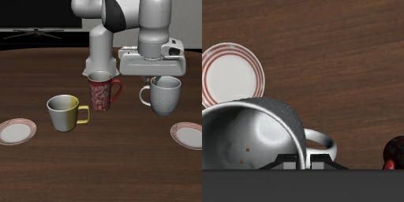
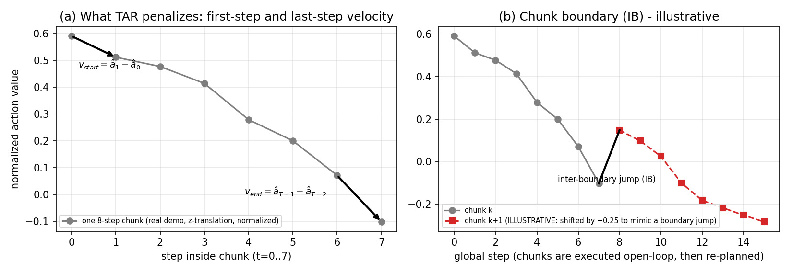
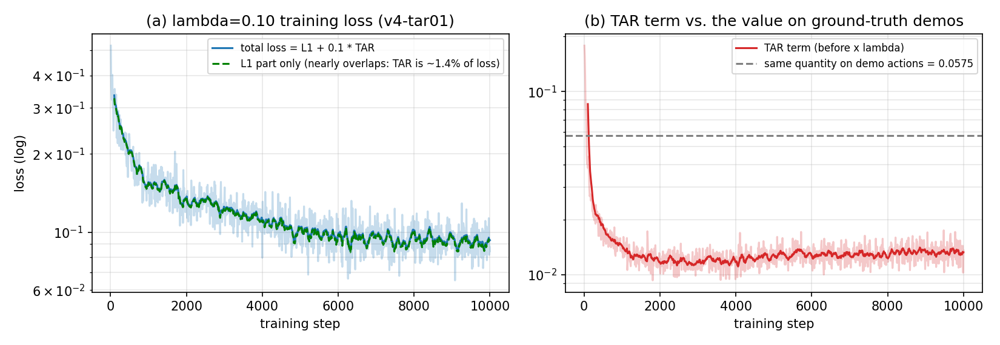
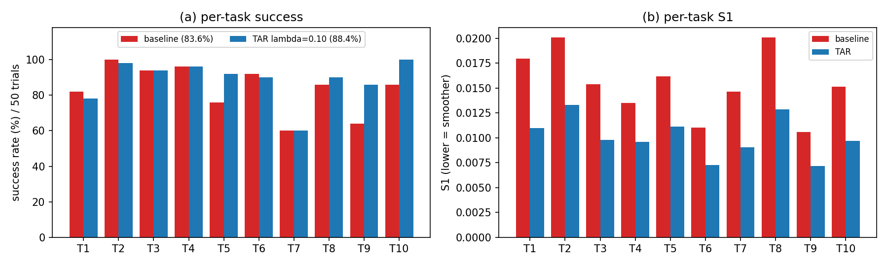
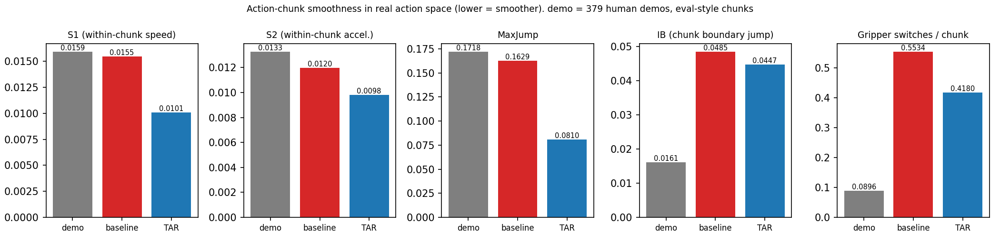

# TAR 方法说明、最新实验数据与重构实验计划

**日期**：2026-10-22  
**汇报人**：何宁秋  
**定位**：本报告**以 2026-10 云端复现的实验结果为唯一立足点**（不再沿用 2026-04/05 的历史数字作结论依据），完成三件事：

1. **§1 说明 TAR 方法本身**：公式、通俗的输入输出、真实数据例子；
2. **§2 完整记录最新已完成实验的全部数据**（训练、评测、平滑度、统计检验、工程验证）；
3. **§3 在这些数据上重新规划后续实验**（含成本估算与决策门槛）。

**配套文件**：数据 `report/data/`（训练曲线 CSV、示教基准 JSON）；图 `report/figures/`；脚本 `scripts/eval_stats.py`、`scripts/demo_reference_stats.py`、`scripts/make_report_figures.py`。上一份阶段报告见 [20261022-seed验证与统计复核进度报告.md](20261022-seed验证与统计复核进度报告.md)。

---

# 1. TAR 方法说明

## 1.1 一句话与直觉

现代机器人大模型（VLA）不是"一步一预测"，而是**一次预测未来 8 步动作（一个 chunk），机器人把这 8 步一口气执行完，再重新看一眼、再预测下一个 8 步**。

> **类比**：像开车时导航每 8 秒才给一次新指令。如果每一段指令的"起步"和"收尾"都很猛（一上来就急加速、结尾还在高速），两段指令之间就容易出现顿挫。

**TAR（Temporal Action Regularization，时序动作正则）** 在训练时额外加一个很小的惩罚项：**让每个 chunk 的第一步和最后一步的"速度"不要太大——"慢启动、慢收尾"**。

- 只改**训练损失**，约 5 行代码；
- **不增加模型参数，不改推理流程，推理零开销**；
- 不需要额外标注（惩罚项只依赖模型自己的预测）。

## 1.2 输入与输出（通俗版）

模型每次"决策"时：

| | 内容 | 形状 / 例子 |
|---|---|---|
| **输入 1：看** | 两张相机图：第三人称相机 + 手腕相机 | 各 256×256 RGB，送入模型时缩放到 224×224 |
| **输入 2：自身状态（proprio）** | 机械臂当前位姿与夹爪开合 | 8 维向量 |
| **输入 3：任务指令** | 一句自然语言 | "put the white mug on the left plate and put the yellow and white mug on the right plate" |
| **输出：未来 8 步动作** | 一个 **8 × 7 的矩阵**：8 个时间步，每步 7 个数 | 见下表 |

**输出每一步的 7 个数的含义**：

| 维度 | 含义 |
|---|---|
| 0, 1, 2 | 末端执行器在 x、y、z 方向的**平移增量**（"往哪走一小步"） |
| 3, 4, 5 | 末端执行器绕三个轴的**旋转增量** |
| 6 | **夹爪**：训练数据中 1 = 张开，0 = 闭合 |

训练时前 6 维按数据集的 1%～99% 分位数**归一化到 [-1, 1]**（夹爪不归一化，保持 0/1）。TAR 损失就是在这个归一化空间里计算的（参数见 `dataset_statistics.json`）。

### 一个真实样本（来自 LIBERO-10 示教数据）

取第 1 条示教轨迹（共 214 步）的第 60 步：



- **指令**：`put the white mug on the left plate and put the yellow and white mug on the right plate`
- **自身状态（8 维，原始值）**：`[-0.0973, -0.1621, 0.5940, 3.0630, 0.2494, -0.1121, 0.0050, -0.0058]`（前 3 维为末端位置，中间 3 维为姿态，后 2 维为夹爪两指位置，按 LIBERO 约定）
- **示教给出的"标准答案"（未来 8 步动作，已归一化）**：

| 步 | Δx | Δy | Δz | Δ旋转1 | Δ旋转2 | Δ旋转3 | 夹爪 |
|---|---|---|---|---|---|---|---|
| 0 | 0.318 | −0.471 | 0.591 | −0.258 | −0.142 | −0.084 | 0 |
| 1 | 0.444 | −0.491 | 0.512 | −0.267 | −0.121 | −0.084 | 0 |
| 2 | 0.493 | −0.511 | 0.477 | −0.276 | −0.093 | −0.084 | 0 |
| 3 | 0.516 | −0.564 | 0.414 | −0.213 | −0.093 | −0.084 | 0 |
| 4 | 0.573 | −0.617 | 0.279 | −0.177 | −0.037 | −0.084 | 0 |
| 5 | 0.577 | −0.633 | 0.200 | −0.177 | −0.037 | −0.084 | 0 |
| 6 | 0.562 | −0.663 | 0.071 | −0.177 | −0.037 | −0.084 | 0 |
| 7 | 0.543 | −0.679 | −0.102 | −0.177 | −0.037 | −0.084 | 0 |

读法：这一段里机械臂一边横向移动，一边在 z 方向逐步"往下放"（Δz 从 0.59 降到 −0.10），夹爪保持闭合（夹着杯子）。

## 1.3 公式

记批大小 $B$，chunk 长度 $T=8$，动作维度 $D=7$。模型预测 $\hat a\in\mathbb{R}^{B\times T\times D}$，示教标签为 $a$。

**标准训练损失（L1 回归）**：

$$
\mathcal{L}_{\text{L1}}=\frac{1}{BTD}\sum_{b,t,d}\left|\hat a_{b,t,d}-a_{b,t,d}\right|
$$

**TAR 项**：先算 chunk 起步速度与收尾速度

$$
v^{\text{start}}_{b,d}=\hat a_{b,1,d}-\hat a_{b,0,d},\qquad
v^{\text{end}}_{b,d}=\hat a_{b,T-1,d}-\hat a_{b,T-2,d}
$$

再取绝对值求平均：

$$
\mathcal{L}_{\text{TAR}}=\frac{1}{BD}\sum_{b,d}\Big(\left|v^{\text{start}}_{b,d}\right|+\left|v^{\text{end}}_{b,d}\right|\Big)
$$

**总损失**：

$$
\boxed{\;\mathcal{L}=\mathcal{L}_{\text{L1}}+\lambda\,\mathcal{L}_{\text{TAR}}\;}
$$

其中 $\lambda$ 是惩罚强度（本次复现 $\lambda=0.10$；$\lambda=0$ 就是不加 TAR 的普通训练）。

**逐项解释**：

| 符号 | 含义 |
|---|---|
| $\hat a_{b,1}-\hat a_{b,0}$ | chunk 内第 0 步到第 1 步的变化量 = 起步"加速度"（动作本身就是增量，所以这里的差是它的变化率） |
| $\hat a_{b,T-1}-\hat a_{b,T-2}$ | 最后两步之间的变化量 = 收尾时还在多快地变化 |
| 取绝对值再平均 | 与 L1 损失同风格；对个别极端大值不过度敏感 |
| $\lambda$ | 权衡：越大越"平滑"，但可能牺牲对示教的拟合精度 |

**与代码的对应**（`openvla-oft/vla-scripts/finetune_bitnet.py`，约 498～504 行）：

```python
loss = torch.nn.L1Loss()(ground_truth_actions, predicted_actions)      # L_L1
v_start = predicted_actions[:, 1, :] - predicted_actions[:, 0, :]
v_end   = predicted_actions[:, -1, :] - predicted_actions[:, -2, :]
tar_loss = (v_start.abs() + v_end.abs()).mean()                          # L_TAR
if tar_lambda > 0.0:
    loss = loss + tar_lambda * tar_loss                                  # L = L_L1 + λ L_TAR
```

## 1.4 用上面的真实样本算一遍

对上表的 chunk（把它当作模型的预测来算），以 Δz 一列为例：

- $v^{\text{start}}_z = 0.512-0.591=-0.079$，$v^{\text{end}}_z=-0.102-0.071=-0.173$；
- $|v^{\text{start}}_z|+|v^{\text{end}}_z| = 0.079+0.173 = 0.252$。

7 个维度分别得到 `[0.145, 0.036, 0.252, 0.009, 0.021, 0, 0]`，平均后 $\mathcal{L}_{\text{TAR}}=0.0661$。

> 这条示教本身的 TAR 值是 0.0661；**全部示教数据（98,816 个 chunk 窗口）的平均 TAR 值是 0.0575**（`report/data/demo_reference_stats.json`）。这是一个有用的参照：它说明"人类示教本身起步和收尾的速度大约是这个量级"。

### 一个可手算的小例子：$\lambda$ 在权衡什么

只看 1 个维度。标准答案 $a=[0.59,\,0.51,\,0.48,\,0.41,\,0.28,\,0.20,\,0.07,\,-0.10]$。两个候选预测：

| 候选 | 预测值 | $\mathcal{L}_{\text{L1}}$ | $\mathcal{L}_{\text{TAR}}$ |
|---|---|---|---|
| A（完全拟合示教） | 与 $a$ 相同 | 0 | $\|0.51-0.59\|+\|-0.10-0.07\|=0.25$ |
| B（首尾压平） | $[0.55,0.51,\dots,0.07,\,0.03]$ | $(0.04+0.13)/8=0.02125$ | $\|0.51-0.55\|+\|0.03-0.07\|=0.08$ |

| $\lambda$ | A 的总损失 | B 的总损失 | 模型倾向 |
|---|---|---|---|
| 0.10 | 0.025 | 0.02925 | A（精确拟合） |
| 0.20 | 0.050 | 0.03725 | B（更平滑） |

两者交叉点在 $\lambda=0.02125/(0.25-0.08)=0.125$。**这就是 $\lambda$ 的含义：用多少拟合精度，去换多少起步/收尾的平缓。**（本例是人为构造的玩具数字，只用于说明机制。）

### 概念示意图



- **(a)** 真实示教中一个 8 步 chunk（z 方向）。TAR 惩罚两个箭头：开头一步和结尾一步的变化量。
- **(b)** 相邻两个 chunk 是**独立预测**的，衔接处可能出现"跳变"（IB）。右图第二段曲线是**人为平移 0.25 构造的示意**，不是真实模型输出。

## 1.5 与推理的关系，以及两个需要如实说明的点

- **推理不变**：训练好的模型照常"预测 8 步 → 开环执行 8 步 → 重新预测"（`num_open_loop_steps=8`）。TAR 只改变了模型学到的"动作形状"。
- **设计动机 vs. 实测效应（重要）**：设计时的动机是"让相邻 chunk 在边界处自然对齐"。但 TAR 实际惩罚的是**同一个 chunk 内部**首尾两步的变化量，**并没有直接约束"前一个 chunk 的最后一步"与"后一个 chunk 的第一步"之间的差**。§2.6 的数据显示：TAR 对 chunk **内部**平滑度的改善很大，对**边界跳变**的改善很小。机理需要进一步实验验证（§3 阶段 B）。
- **夹爪维度也被惩罚**：TAR 对 7 维一视同仁。夹爪是 0/1 切换的"开关量"，在 chunk 首尾发生切换时本应出现大变化，TAR 会对此施加惩罚。这是否有利是一个待验证的设计选择（§3 阶段 B）。

## 1.6 评估指标定义

评测时对每个 rollout 记录模型每次预测的 chunk（共 $N$ 个）$C_1,\dots,C_N$，每个 $C_k\in\mathbb{R}^{8\times7}$，**在反归一化后的真实动作空间**计算（注意：训练里的 TAR 值在归一化空间，两者**数值不可直接比较**）：

| 指标 | 公式 | 含义 |
|---|---|---|
| **成功率** | 成功 episode 数 / 总数 | 主指标 |
| **S1** | $\overline{\left\lvert C_{k,t+1}-C_{k,t}\right\rvert}$（chunk 内所有相邻步、所有维度的平均绝对差） | chunk 内平均"速度变化" |
| **S2** | $\overline{\left\lvert C_{k,t+2}-2C_{k,t+1}+C_{k,t}\right\rvert}$ | chunk 内平均"加加速度"（二阶变化） |
| **MaxJump** | $\max_{t,d}\left\lvert C_{k,t+1,d}-C_{k,t,d}\right\rvert$（每个 chunk 取最大，再对 chunk 平均） | chunk 内最猛的一步 |
| **IB** | $\overline{\left\lvert C_{k+1,0}-C_{k,7}\right\rvert}$ | **相邻 chunk 衔接处**的跳变（上一段最后一步 vs 下一段第一步） |
| **GripperSw** | chunk 内夹爪维度穿过阈值 0 的次数（chunk 平均） | 夹爪开合次数 |

先行说明局限：GripperSw 的阈值固定为 0，而夹爪取值范围是 [0,1]（模型输出为连续值），这个计数更像"夹爪输出在 0 附近抖动的程度"，**不是严格的开合次数**，解读时需谨慎（§2.6 F6）。

---

# 2. 最新已完成实验的详细数据

## 2.1 实验设置

| 项 | 值 |
|---|---|
| 任务集 | LIBERO-10（10 个长程任务），`libero_10_no_noops` |
| 训练数据规模 | **379 条示教轨迹，101,469 个 transition**；轨迹长度均值 267.7（最短 150，最长 505） |
| 基座模型 | BitVLA（`bitvla-bf16`，1.58-bit 量化 VLA，约 3B 参数） |
| 动作 chunk | $T=8$，$D=7$；评测开环执行 8 步 |
| 训练硬件 | 4 × NVIDIA GeForce RTX 4090D（24GB），FSDP（FULL_SHARD）+ gradient checkpointing |
| 评测硬件 | 1 × RTX 4090D |
| 软件 | Python 3.10；torch 2.5.0+cu124；transformers 4.51.0.dev0（修改版）；TensorFlow 2.15.0；mujoco **2.3.7**；robosuite **1.4.1**；渲染 `MUJOCO_GL=osmesa` |
| 云实例 | AutoDL |

**训练超参**（`scripts/train_tar.sh`）：

| 参数 | 值 |
|---|---|
| 总步数 | 10001 |
| 有效 batch | 64（bs 2 × 梯度累积 8 × 4 卡） |
| 学习率 | 4e-4（ViT 部分 8e-5），warmup 375 步后余弦衰减至接近 0（最后一步 4.3e-11） |
| 数据增强 | `image_aug=True`（随机裁剪、亮度、对比度、饱和度、色调） |
| shuffle buffer | 100,000 |
| **TAR 强度** | **λ = 0.10** |
| 随机种子 | **未设置**（本批实验尚无 seed 代码） |

**评测协议**（`scripts/eval_tar.sh`）：LIBERO-10，**每任务 50 trials，共 500 episodes**；LIBERO 固定初始状态；`num_images_in_input=2`、`use_proprio=True`、`center_crop=True`；最大步数预算 520（= 65 个 chunk）；eval seed=7。

**两个被比较的模型**：

| | Baseline | TAR |
|---|---|---|
| 权重 | 官方 `ft-bitvla-libero-long`（**未重训**） | 本次新训 `v4-tar01`，step 10000 |
| λ | 0（官方训练，未用 TAR） | 0.10 |
| 评测日期 | 2026-10-03 | 2026-10-02 |

> **一个需要在论文中交代的不对称**：baseline 是官方权重（据 v3 报告，其训练使用 4 卡 DDP；本次 TAR 使用 FSDP），并非"同一份代码、同一环境重训的 λ=0"。这一点在 §3 阶段 A 通过重训 λ=0 对照来消除。

## 2.2 训练过程（`v4-tar01`，λ=0.10）

数据来源：wandb 离线记录（每 10 步一条，共 1000 条），已导出为 `report/data/v4tar01_train_curve.csv`。

| 项 | 值 |
|---|---|
| Run ID | `bitvla-bf16+libero_10_no_noops+b16+lr-0.0004--image_aug--v4-tar01--image_aug+tar-0.1` |
| 起止 | 2026-09-30 11:10 → 2026-10-02 13:24 |
| 总时长 | **50.2 小时**（平均 **18.06 秒/步**） |
| 终止 | 到达 step 10001；可用 checkpoint 为 `--10000_chkpt`（约 12GB） |
| 启动历史 | 2026-09-30 00:02 的第一次启动在约第 50 步（约 20 分钟）时因终端挂断（SIGHUP）被终止，11:10 起从头重新训练；最终模型来自第二次启动 |

**损失曲线关键点**（单次记录值，波动较大）：

| step | 总 loss | 当前步 L1 | 后 7 步 L1 | TAR 项（未乘 λ） | 学习率 |
|---|---|---|---|---|---|
| 10 | 0.5208 | 0.4822 | 0.5059 | 0.1781 | 9.6e-06 |
| 100 | 0.2867 | 0.2902 | 0.2820 | 0.0383 | 1.06e-04 |
| 500 | 0.2316 | 0.2328 | 0.2295 | 0.0188 | 4.00e-04 |
| 1000 | 0.1743 | 0.1584 | 0.1754 | 0.0136 | 3.96e-04 |
| 2000 | 0.1259 | 0.1227 | 0.1249 | 0.0108 | 3.73e-04 |
| 5000 | 0.0981 | 0.1108 | 0.0949 | 0.0124 | 2.12e-04 |
| 7000 | 0.0919 | 0.0940 | 0.0901 | 0.0115 | 8.86e-05 |
| 9000 | 0.0916 | 0.0954 | 0.0897 | 0.0133 | 1.06e-05 |
| 10000 | 0.0845 | 0.0876 | 0.0825 | 0.0135 | 4.3e-11 |

**窗口平均**（更稳健，建议引用这组而不是单步值）：

| 区间 | 总 loss | TAR 项 |
|---|---|---|
| (0, 500] | 0.2588 | 0.0352 |
| (500, 1000] | 0.1699 | 0.0153 |
| (1000, 2000] | 0.1449 | 0.0126 |
| (2000, 5000] | 0.1172 | 0.0120 |
| (5000, 9000] | 0.0956 | 0.0130 |
| **(9000, 10000]** | **0.0919** | **0.0132** |



**观察**：

- 总 loss 与 $\mathcal{L}_{\text{L1}}+0.1\,\mathcal{L}_{\text{TAR}}$ 完全吻合（如 step 10000：$(0.0876+7\times0.0825)/8+0.1\times0.0135=0.08449$，日志为 0.08453），代码实现与公式一致。
- TAR 项在前约 2000 步迅速降到约 0.011～0.014 后基本持平；乘上 λ=0.1 后只占总 loss 的约 **1.4%**，所以图 2(a) 中两条线几乎重合。
- **TAR 项收敛值（≈0.0132）只有示教数据同一量级（0.0575）的约 23%**：模型预测的 chunk 首尾比人类示教平缓得多（见 §2.6 F5 的限定说明）。
- 说明：旧报告引用的"最终 loss ≈ 0.085"是单步记录值；末 1000 步的平均是 0.0919。

## 2.3 评测结果：成功率

| 模型 | 成功数 | 成功率 | 95% 置信区间（Wilson） |
|---|---|---|---|
| Baseline（官方 `ft-bitvla-libero-long`） | 418 / 500 | **83.6%** | [80.1%, 86.6%] |
| TAR λ=0.10（`v4-tar01`） | 442 / 500 | **88.4%** | [85.3%, 90.9%] |
| 差值 | +24 次 | **+4.8 pp** | 配对 bootstrap 95% CI **[+1.0, +8.8]** |

**配对检验**（同任务、同 episode 编号 = 同一初始状态）：

| 两者都成功 | 仅 TAR 成功 | 仅 baseline 成功 | 两者都失败 |
|---|---|---|---|
| 377 | 65 | 41 | 17 |

- **McNemar 精确检验（双侧）p = 0.025**；非配对两比例 z 检验：z = 2.19，单侧 p = 0.014（仅供参考）。
- 耗时：TAR eval 约 13.5 h（2026-10-02 14:01 → 10-03 03:28）；baseline eval 约 13 h（10-03 07:19 → 20:35）。

**失败的全部是超时**：两个模型所有失败的 episode 都恰好用满 65 个 chunk（= 520 步预算）。失败数：baseline 82，TAR 58（少 24 次）。成功 episode 的平均用时几乎没变（baseline 31.6 个 chunk，TAR 32.9 个）——**TAR 的收益体现在"更多 episode 能在预算内完成"，而不是"完成得更快"**。

## 2.4 逐任务成功率



| # | 任务 | Baseline | TAR | Δ | 仅 TAR 成功 / 仅 baseline 成功 | McNemar p | Bonferroni(10) p |
|---|---|---|---|---|---|---|---|
| 1 | alphabet soup + tomato sauce → basket | 82% | 78% | −4% | 8 / 10 | 0.81 | 1.00 |
| 2 | cream cheese + butter → basket | 100% | 98% | −2% | 0 / 1 | 1.00 | 1.00 |
| 3 | stove + moka pot | 94% | 94% | 0% | 3 / 3 | 1.00 | 1.00 |
| 4 | black bowl → drawer | 96% | 96% | 0% | 1 / 1 | 1.00 | 1.00 |
| 5 | white mug 左盘 + yellow mug 右盘 | 76% | 92% | +16% | 12 / 4 | 0.077 | 0.77 |
| 6 | book → caddy | 92% | 90% | −2% | 0 / 1 | 1.00 | 1.00 |
| 7 | white mug 上盘 + pudding 放右 | 60% | 60% | 0% | **11 / 11** | 1.00 | 1.00 |
| 8 | soup + cream cheese → basket | 86% | 90% | +4% | 7 / 5 | 0.77 | 1.00 |
| 9 | both moka pots on stove | 64% | 86% | **+22%** | 16 / 5 | 0.027 | 0.27 |
| 10 | yellow mug → microwave | 86% | 100% | **+14%** | 7 / 0 | 0.016 | 0.16 |

- **没有任何单个任务在多重比较校正后显著**；总体显著性来自多个任务的叠加。因此**不应对"哪类任务受益最大"下结论**，只能说提升主要出现在 Task 5、9、10。
- Task 7 两个模型都是 60%，但各自失败的 episode 并不相同（11 对 11）：不是"某几个固定的难初始状态"，而是策略在该任务上本身不稳定。

## 2.5 平滑度指标（500 episodes 聚合）

为了判断"平滑到什么程度算合适"，我额外用 **379 条人类示教**在同样的指标定义下算了一组参照值（非重叠 8 步 chunk，真实动作空间；`report/data/demo_reference_stats.json`）：

| 指标（越低越平滑） | 示教（参照） | Baseline | TAR | TAR 相对 baseline | TAR / 示教 |
|---|---|---|---|---|---|
| S1 | 0.0159 | 0.0155 | **0.0101** | **−34.7%** | 0.63× |
| S2 | 0.0133 | 0.0120 | **0.0098** | −18.1% | 0.74× |
| MaxJump | 0.1718 | 0.1629 | **0.0810** | **−50.3%** | 0.47× |
| IB（chunk 衔接跳变） | 0.0161 | 0.0485 | 0.0447 | **−7.8%** | **2.78×** |
| GripperSw（见 §1.6 局限） | 0.0896 | 0.5534 | 0.4180 | −24.5% | 4.67× |



**其它聚合量**：

| | Baseline | TAR |
|---|---|---|
| 成功 episode 的 S1 | 0.01538 | 0.01027 |
| 失败 episode 的 S1 | 0.01585 | 0.00869 |
| 失败 episode 的 chunk 数 | 全部 65（超时） | 全部 65（超时） |

**逐任务平滑度**（500 个 episode 按任务分组；S1 在 10/10 个任务上 TAR 都更低）：

| # | S1 base → TAR | MaxJump base → TAR | IB base → TAR | GripperSw base → TAR | 平均 chunk 数 base → TAR |
|---|---|---|---|---|---|
| 1 | 0.0180 → 0.0110 | 0.2056 → 0.0966 | 0.0609 → 0.0527 | 0.619 → 0.340 | 39.5 → 43.0 |
| 2 | 0.0201 → 0.0133 | 0.2130 → 0.1057 | 0.0569 → 0.0573 | 0.620 → 0.483 | 32.2 → 31.5 |
| 3 | 0.0154 → 0.0098 | 0.1574 → 0.0813 | 0.0399 → 0.0398 | 0.481 → 0.379 | 31.8 → 33.4 |
| 4 | 0.0135 → 0.0096 | 0.1117 → 0.0666 | 0.0357 → 0.0386 | 0.409 → 0.361 | 30.5 → 32.5 |
| 5 | 0.0162 → 0.0111 | 0.1658 → 0.1016 | 0.0465 → 0.0452 | 0.579 → 0.469 | 36.8 → 31.9 |
| 6 | 0.0111 → 0.0073 | 0.0842 → 0.0510 | 0.0376 → 0.0332 | 0.714 → 0.617 | 25.6 → 28.4 |
| 7 | 0.0147 → 0.0091 | 0.1863 → 0.0755 | 0.0514 → 0.0413 | 0.651 → 0.615 | 43.8 → 45.4 |
| 8 | 0.0201 → 0.0128 | 0.2563 → 0.1132 | 0.0691 → 0.0556 | 0.673 → 0.417 | 38.1 → 35.9 |
| 9 | 0.0106 → 0.0072 | 0.1218 → 0.0559 | 0.0359 → 0.0345 | 0.451 → 0.300 | 55.1 → 51.3 |
| 10 | 0.0151 → 0.0097 | 0.1266 → 0.0626 | 0.0506 → 0.0487 | 0.337 → 0.199 | 37.5 → 33.1 |

## 2.6 主要观察（F1–F8）

| 编号 | 观察 | 证据 |
|---|---|---|
| **F1** | **TAR 提升成功率，统计上成立但下界偏弱**。 | +4.8 pp，McNemar p=0.025，配对 CI [+1.0, +8.8] |
| **F2** | **收益来自"更少超时"**，不是更快完成。 | 失败数 82→58；成功 episode 平均 chunk 数 31.6 vs 32.9 |
| **F3** | **TAR 的 chunk 内平滑度改善很大，而且比人类示教更平滑**。baseline 的 S1/MaxJump 与示教几乎相同（0.97×、0.95×），TAR 降到 0.63×、0.47×。 | §2.5 表 |
| **F4** | **chunk 衔接跳变（IB）几乎没被改善**：−7.8%；baseline 的 IB 是示教的 3.0×，TAR 仍是 2.8×。IB/S1 比值从 baseline 的 3.1 **升到** TAR 的 4.4（示教为 1.0）。 | §2.5 表 |
| **F5** | 训练中的 TAR 项收敛到 0.0132，仅为示教同量级（0.0575）的 23%。**但没有 baseline 的对应值**（官方 baseline 训练时未记录），所以无法判断这是 TAR 造成的，还是 L1 回归本身就偏平滑。 | §2.2 |
| **F6** | 夹爪开合计数大幅下降（−24.5%），但两个模型都远高于示教（4.7×～6.2×）。由于阈值定义（§1.6），这更可能反映"夹爪输出在 0 附近抖动"，不是真实开合次数。 | §2.5 表 |
| **F7** | 逐任务看，S1 在 **10/10** 任务上都下降；成功率变化在任务间不一致，且单任务均不显著。 | §2.4、§2.5 |
| **F8** | 失败 episode 的 S1 在 TAR 下反而比成功 episode 更低（0.0087 vs 0.0103），baseline 则两者相同。可能与"机械臂在原地犹豫、动作变小直到超时"有关，**需要看失败录像或原始轨迹才能确认**。 | §2.5 |

**这些观察对"方法如何表述"的含义**：

- 数据支持"TAR 让动作更平滑、同时成功率更高"。
- 数据**不支持**"TAR 通过消除 chunk 边界跳变来提升成功率"这一机制说法（F4）。更准确的描述是"在 chunk 首尾施加速度惩罚，带来了整体更平滑的动作输出"。
- "平滑到比示教还平滑（F3）"是否是收益来源、是否有上限，是后续实验要回答的问题。

## 2.7 工程验证记录

| 验证项 | 结果 |
|---|---|
| **分片 eval 与整体 eval 一致性**（v4-tar01，Task 5，50 trials，1 个分片） | 原 eval 46/50 vs 分片 46/50（92%）；**50 个 episode 的成败逐个完全相同**。结论：eval 是确定性的（同 checkpoint、同初始状态重跑结果相同），分片并行不改变结果；因此**换 eval seed 没有信息量**，成功率的波动只来自训练 |
| 单任务 50 trials 耗时 | 约 1 小时（约 1 episode/分钟） |
| 同卡并发 | 意外的重复启动期间，两个 eval 进程同时在一张 4090D 上稳定运行（各占显存约 7GB），说明单卡可并行 2 路以上（3 路未实测） |
| 训练 `--seed` 数据管线（合成数据） | 相同 seed 得到完全相同序列；不同 seed 完全不同；不传 seed 则每次不同 |
| 训练 `--seed` 真实管线 | 在 GPU 上带 `--seed 1` 成功启动并进入训练循环，日志出现 `[seed] global seed = 1 (data seed on this rank = 100)` |
| **单卡训练**（1×4090D，`NPROC=1`，105 步） | **第一次 `optimizer.step()` 时 CUDA OOM**（已占 22.7GB）。前向、反向都通过，失败点在优化器状态。结论：**全参数微调必须 4 卡 FSDP** |
| 完整真实 RLDS 管线的 CPU 对照测试 | 因开发机内存上限 2GiB 被系统终止，未做 |
| FSDP 多卡下 seed 的真实行为 | **尚未验证**，需 4 卡 smoke test |

## 2.8 数据完整性与已知局限

| 项 | 状态 |
|---|---|
| 训练曲线、eval 日志、smoothness JSON、500 个回放 MP4 | ✅ 完整保留 |
| **原始 chunk 动作轨迹** | ❌ **没有保存**（eval 只存了聚合后的指标）。因此无法事后重算新指标，也无法画真实的"baseline vs TAR 轨迹对比图"。**后续 eval 应保存原始 chunk** |
| λ=0 同 recipe 的重训、其训练曲线 | ❌ 无 |
| baseline 的 TAR 项数值（teacher-forcing 下） | ❌ 无（可用 1 张 GPU 补，见 §3 诊断 D1） |
| 训练随机性（seed） | ❌ 没有任何多 seed 数据 |
| 示教"参照基准"的口径 | 使用全部 379 条示教、非重叠 8 步 chunk；模型 rollout 的状态分布与示教不同，**参照值用于量级对照，不是严格的同分布比较** |

---

# 3. 重构后的实验计划

## 3.1 立足点与要回答的问题

**立足点**（来自 §2，作为后续实验的前提）：

- P1：同一环境、同一评测协议下，加入 TAR（λ=0.10）后成功率由 83.6% 提升到 88.4%（+4.8 pp，p=0.025），平滑度指标大幅改善。
- P2：eval 是确定性的，评测噪声主要来自**训练**。
- P3：TAR 对 chunk 内平滑度的作用很强，对 chunk 边界跳变的作用很弱。

**需要回答的问题**（按"一篇论文需要的证据链"排序）：

| 编号 | 问题 | 为什么 |
|---|---|---|
| **RQ1 稳健性** | TAR 的提升是否在不同训练随机种子下稳定存在？ | 目前只有"一次训练 vs 一个官方权重"，P1 的效应量不确定（CI 下界仅 +1.0 pp） |
| **RQ2 机理** | TAR 起作用靠的是"边界"本身，还是"整体速度平滑"？夹爪维度是否应排除？ | F3/F4 与方法的原始动机不一致，论文需要正确的解释 |
| **RQ3 强度** | λ 取多大合适？有无饱和或副作用？ | 目前只有 λ=0.10 一个点 |
| **RQ4 泛化** | 在其它 LIBERO 子集 / 其它模型上是否也有效？ | 单 benchmark、单模型难以支撑通用性结论 |
| **RQ5 真实价值** | 平滑度改善对真机是否有意义？ | 长期 |
| **RQ6 定位** | 与推理侧连续性方案（temporal ensembling 等）相比，训练期零开销的 TAR 值多少？二者是否互补？ | 单一损失项的新颖性有限（见下），需要靠对比与分析建立论文价值 |

### 3.1.1 贡献定位（相关工作核对）

经检索，**chunk 边界连续性与动作平滑已有较多工作**（仅核对了摘要，写论文前需通读原文）：

| 工作 | 阶段 | 做法 | 与 TAR 的关系 |
|---|---|---|---|
| ACT temporal ensembling | 推理 | 对重叠预测加权平均 | 推理开销大；对照基线 |
| RTC（arXiv 2506.07339） | 推理 | 冻结已执行动作并"补全"其余 | 仅适用于 diffusion/flow 策略，**不适用于本课题的 L1 回归头** |
| SEAM（arXiv 2607.04609） | 推理 | 用上一 chunk 尾部做引导 | 仅适用于 flow 策略；报告 LIBERO-10 边界 jerk −28% |
| Training-time RTC（arXiv 2512.05964） | 训练 | 训练时模拟延迟、以前缀为条件 | 解决延迟而非平滑 |
| **ChunkFlow（arXiv 2607.12992）** | 训练+执行 | **seam 损失 + 一/二阶连续性损失** + 重叠混合 | **与"加一个跨 chunk 衔接损失"高度重叠** |
| 平滑正则的负面结果（Frontiers in Neurorobotics 2026，SmolVLA） | 训练 | 速度/平滑正则 | 小预算下可能**使性能崩溃、jerk 反增**；指出夹爪被当连续量惩罚是隐患 |

**判断**：

- 单看"一个 5 行的速度惩罚项"，方法新颖性确实偏薄，投稿档次受限。
- **不建议再叠加"跨 chunk 衔接损失"作为新创新点**：它会直接落入 ChunkFlow 的范围，且需要改数据管线、训练开销翻倍。该项保留为 B4（后置）。
- 更可辩护的做法是**不加新损失，而是把贡献定位在下面三点**，它们都能由本课题已有数据和少量低成本实验支撑：

| 贡献 | 通俗描述 | 技术内容 | 证据来源 |
|---|---|---|---|
| **C1 适用场景** | 别人的"防抖"办法要么换不上我们的模型，要么运行时很费算力；我们在**训练时**加一条规则，**运行时一点不多花**，所以能用在小而快的模型上。（类比：别人是拍照后逐张修图，我们是教摄影师手稳一点。） | 面向**确定性回归头 / 低比特（1.58-bit）VLA** 的**训练期零开销**连续性手段；RTC、SEAM 这类推理侧方案依赖 flow/diffusion，对这类模型不适用，temporal ensembling 则需 ~8× 推理次数 | §2.3；新增 D6 |
| **C2 机理发现** | 我们发现效果好的**原因和原先设想不一样**：不是"每段动作衔接上了"，而是"动作整体比人类示范还平稳"，机器人少了犹豫和抖动，就不容易超时失败；而段与段之间的小顿挫其实基本没修好。这个"为什么有效"的答案，别人还没讲清楚。 | ① 收益来自"比示教更平滑"而非"贴近示教"（S1 为示教的 0.63×，baseline 为 0.97×）；② IB 仍是示教的 2.8×，边界跳变基本未被修复 | §2.5、F3/F4；新增 B3 排除"只是示教去噪" |
| **C3 评测协议** | 以前只看"每段动作内部抖不抖"，容易被糊弄。我们提供一把**更公平的尺子**：拿人类示范当参照（"比示范平滑多少倍"），并直接看机器人**实际走出来的轨迹**抖不抖。 | 以示教为参照的平滑度指标（含 IB/S1 比值）+ **实际执行轨迹的 jerk**，补足仅看 chunk 内统计的不足 | §2.5；新增 D4/D2 |

方法本身的改进只保留**经证据支持的小改动**：B2（屏蔽夹爪维度，文献也指出夹爪是隐患），其余视 B1/B3 的结果再定。

## 3.2 评测与分析规范（所有后续实验统一遵守）

1. **对照必须同条件**：每个 TAR 实验配一个同 seed、同代码、同 FSDP 设置的 λ=0 对照；不再用"官方权重"当唯一 baseline。
2. **成功率报告**：每个模型报告 Wilson 95% CI；同 seed 的 TAR 与对照做配对 McNemar；跨 seed 报告各 run 的数值与均值，**样本很少时不报标准差，直接列出全部数值与范围**。
3. **决策门槛在跑之前定好**（见 §3.3 各阶段），避免结果出来后摇摆。
4. **eval 必须保存原始 chunk 与实际执行的动作序列**（`npz`），并同时报告示教参照值、IB/S1 比值，以及**执行轨迹的 jerk**（实际执行动作二阶差分的 RMS，不依赖 chunk 结构，推理侧方案也可比较）。
5. **修正 GripperSw 定义**：按夹爪 0.5 阈值计数（0/1 开关量），并保留旧定义以便与本报告对照。
6. **eval 只跑一次**（确定性），不再花算力在 eval seed 上。

## 3.3 分阶段实验方案

> 成本记号：**训练 = 4 卡约 50 h/次**（实测 18.06 s/步 × 10001 步 = 50.2 h，约 200 GPU·h）；**评测 = 约 13 GPU·h/500 episodes**（OSMesa，CPU 渲染为瓶颈，可分片/同卡并行缩短墙钟）。

### 阶段 0：无需 4 卡、现在就能做

| 编号 | 实验/工作 | 资源 | 产出 |
|---|---|---|---|
| **D1** | **teacher-forcing 诊断**：把 baseline 与 TAR 的权重分别在训练集样本（如 5,000 个）上做前向，计算预测 chunk 的 $\mathcal{L}_{\text{TAR}}$、S1、首尾速度，与示教对照；并拆分"机械臂 6 维 / 夹爪 1 维" | 1 GPU，约 1～2 h | 回答 F5：baseline 本来的 TAR 值是多少？TAR 把它降了多少？首尾是否被"压平"？ |
| **D2** | **带原始 chunk 的重评**：用现有 `v4-tar01` 与官方 baseline 权重重跑 eval，保存原始 chunk，修正 GripperSw | 1 GPU，约 26 GPU·h（单卡 2～3 路并行约 9～13 h 墙钟） | 可事后做：真实轨迹对比图、IB 分解、F8 的"犹豫"检验；结果应与 §2.3 一致（验证确定性） |
| **D3** | 失败录像抽检：Task 7、9 以及 TAR 的失败 episode（共 58 个 MP4 已保存） | CPU/人工 | 解释 F8 与 Task 7 的不稳定性 |
| **D4** | 代码：eval 加原始 chunk / 执行动作保存、执行轨迹 jerk、GripperSw 新定义、temporal ensembling 开关；训练加"mask 夹爪""全 chunk 速度惩罚""示教时间轴低通平滑"三个选项（阶段 B 需要） | 无 | 为后续阶段做好准备 |
| **D5** | 文档修正：附录 A 的 λ 标注；baseline 总成功率与旧逐任务表不一致的核实 | 无 | 避免旧数据误导 |
| **D6** | **推理侧对比（只需评测）**：baseline / TAR 各加 temporal ensembling 重评（权重 $w_i=e^{-m\,i}$），记录成功率、执行 jerk、每 episode 推理调用次数 | 1 GPU，约 26～40 GPU·h（估，推理次数约 8×） | 回答 RQ6：TAR 的收益是否与 TE 相当？TE+TAR 是否叠加？支撑贡献 C1 |
| **D7** | **边界是否真的有害（只需评测）**：把开环步数从 8 降到 4（更频繁重新规划）重评 baseline / TAR | 1 GPU，约 26～30 GPU·h（估） | 若 baseline 在 4 步下明显变好、TAR 与 baseline 的差距收窄，说明边界跳变确实影响成功率（支持 B4 值得做）；若无变化，则边界不是主因，B4 可放弃 |

**门槛 G0**：D1 若显示 **baseline 的 TAR 值本来就接近 0.0132**，则 TAR 项可能不是主要因素，阶段 B 的机理实验优先级上升；若显示 baseline 的值明显更高（如接近示教的 0.0575），则确认 TAR 确实在把首尾"压平"。

### 阶段 A：稳健性（RQ1）——必做

| 编号 | 训练 | seed | 评测 |
|---|---|---|---|
| A1 | TAR λ=0.10 | 1 | 1 次 |
| A2 | TAR λ=0.10 | 2 | 1 次 |
| A3 | **对照 λ=0**（同 recipe 重训） | 1 | 1 次 |
| A4 | 对照 λ=0 | 2 | 1 次 |

- **前置**：在 4 卡上做 100 步 seed smoke test（约 0.5 h），确认 FSDP 下各卡数据 batch 不同、训练正常。
- **成本**：4 次训练约 **200 h（4 卡墙钟）**，评测约 52 GPU·h。**最小版**：A1+A2+A3（150 h + 39 GPU·h），代价是对照只有 1 个 seed。
- **与已有数据的关系**：现有 `v4-tar01`（未设 seed，TAR 88.4%）与官方 baseline（83.6%）作为**补充参考**，不与受控实验混合统计。
- **门槛 G1**：
  - **通过**：每个 seed 的 TAR 都高于同 seed 的 λ=0，且平均差 ≥ +2 pp → 主结论成立，进入阶段 B/C。
  - **部分通过**：方向一致但差值 < 2 pp，或个别 seed 反向 → 论文表述降级为"平均提升、run 间有波动"，阶段 C 优先扩大样本而非扩大 λ 范围。
  - **不通过**：多数 seed 无提升 → 回头审视 P1，重点转向机理与平滑度本身的价值。

### 阶段 B：机理（RQ2）——强烈建议

在 seed=1、λ=0.10 条件下各训 1 个变体，与 A1/A3 对比（先做筛选，差异大再补 seed）：

| 编号 | 变体 | 要检验的假设 |
|---|---|---|
| **B1** | **全 chunk 速度惩罚**：对 chunk 内所有相邻步 $\|\hat a_{t+1}-\hat a_t\|$ 求平均 | 如果 B1 的效果与 TAR 相同甚至更好 → "只惩罚首尾"不是关键，方法应改述为"速度正则" |
| **B2** | **TAR 但屏蔽夹爪维度**（只对前 6 维施加） | 夹爪开关量被惩罚是否有害/无关 |
| **B3** | **示教去噪对照（λ=0）**：训练前把示教动作沿时间轴低通平滑（夹爪不动），使示教的 S1 降到约 0.6×（与 TAR 模型相当），不加 TAR | 排除"TAR 只是在隐式地给带噪的遥操作示教去噪"这一最强替代解释；若 B3 ≈ TAR，贡献 C2 要改写为"示教平滑"；若 TAR 更好，说明确有正则效应 |
| B4（后置） | **跨 chunk 衔接损失**：同一 episode 中相邻两个 chunk 联合训练，直接惩罚 IB | 仅当 D7 显示边界跳变确实影响成功率时才做；与 ChunkFlow 重叠（§3.1.1），需改数据管线、训练开销约翻倍 |
| B5（可选） | 只惩罚起步 / 只惩罚收尾 | 哪一端贡献更大；信息量低于 B1–B3，放最后 |

- **成本**：B1+B2+B3 共 3 次训练，约 150 h + 39 GPU·h；B4、B5 视情况。
- **门槛 G2**：根据 B1/B2/B3 与 A1 的差异，决定方法的**最终形式与论文表述**：

| 结果 | 表述 |
|---|---|
| B1 ≥ TAR | "全 chunk 速度正则"（首尾设计不是关键） |
| B2 ≥ TAR | 方法默认屏蔽夹爪维度 |
| B3 ≈ TAR | 收益主要来自示教去噪，C2 改写 |
| 均不优于 TAR | 保留 TAR 现形式 |

### 阶段 C：λ 敏感性（RQ3）

在最终形式确定后：

| 编号 | λ | seed |
|---|---|---|
| C1 | 0.05 | 1 |
| C2 | 0.20 | 1 |
| C3 | 0.50 | 1 |

- 与 A 阶段的 λ=0、λ=0.10 构成 5 点曲线。**单 seed 的成功率噪声较大**，因此该阶段以**平滑度指标（样本多、噪声小）+ 成功率趋势**为主，并以 G1 的 seed 间波动作为"判定为有差异"的尺度。
- **成本**：3 次训练约 150 h + 39 GPU·h。
- **目的**：找到推荐的 λ 区间、判断是否存在"过平滑导致成功率下降"的拐点（F3 已显示 λ=0.10 已比示教平滑）。

### 阶段 D：泛化（RQ4）

| 编号 | 实验 | 说明 |
|---|---|---|
| D-a | **LIBERO-Spatial** 上 baseline vs TAR（最终 λ） | 先做 Spatial 作为 pilot（任务最短、成本最低），各训 1 次 |
| D-b | LIBERO-Object、LIBERO-Goal | 视 D-a 结果扩展 |
| D-c | 其它 chunk-based 策略（如 OpenVLA-OFT、SmolVLA 等） | 需要先评估显存与代码适配可行性（7B 级模型在 24GB 卡上全参数微调很可能不可行） |

- **成本（估算，需核实）**：每个 suite 每个臂约 40～50 h；单 suite 2 个臂约 100 h；三个 suite 约 300 h。官方是否提供各 suite 的微调权重需要先核实（可免去 baseline 重训，但会引入与阶段 A 同类的"不同训练条件"问题）。
- **门槛 G3**：Spatial pilot 中 TAR 不退步（Δ ≥ 0）且平滑度同向改善，才继续扩展。

### 阶段 E：长期

真机验证（平滑度对硬件执行的实际价值）、自适应 λ 调度。依赖实验室资源，不纳入近期排期。

## 3.4 优先级与资源汇总

| 优先级 | 内容 | 训练次数 | 4 卡训练墙钟 | 评测 GPU·h | 前提 |
|---|---|---|---|---|---|
| **P0（现在）** | 阶段 0（D1–D7） | 0 | 0 | 约 2～110（D2/D6/D7 为大头，均为估算，可按需取舍） | 1 张 GPU 即可 |
| **P1（必做）** | 阶段 A（A1–A4，最小版去掉 A4） | 4（最小 3） | 约 200 h（最小 150 h） | 52（最小 39） | 4 卡 |
| **P1（强烈建议）** | 阶段 B（B1, B2, B3） | 3 | 约 150 h | 39 | G1 通过 |
| **P2** | 阶段 C（C1–C3） | 3 | 约 150 h | 39 | G2 |
| **P2** | 阶段 D-a（Spatial pilot） | 2 | 约 100 h（估） | 待估 | G2/G3 |
| P3 | 阶段 B4/B5、D-b/c、E | — | — | — | 视 D7 与前序结果 |

- **近期最小可发表证据包**：P1(A) + P1(B)：约 **7 次训练，约 350 h（约 14.5 天）4 卡时间 + 约 91 GPU·h 评测**（不含 P0）。
- **完整版**（再加 P2）：约 12 次训练，约 600 h（约 25 天）+ 约 130 GPU·h 评测（不含 D-a 的评测，待估）。
- eval 可通过分片把墙钟压到约 1/4（4 卡）；总 GPU 工作量不变。

## 3.5 排期顺序与依赖

```text
现在（1 GPU / 无 GPU）
  D5 文档修正 ──┐
  D4 代码准备 ──┼─► D1 诊断 ─► G0
  D2 重评 / D3 失败录像 ──┤
  D6 TE 对比 / D7 开环步数 ──┘ （D7 决定 B4 是否值得做）
拿到 4 卡
  smoke test(100 步) ─► A1 → A2 → A3 → (A4)   [串行，约 50 h/次；评测可与下一次训练并行]
                          └─► G1 ─► B1 → B2 → B3 ─► G2 ─► C1~C3 ─► D-a ─► G3
```

- 训练串行执行时，上一个模型的评测可以与下一个模型的训练**并行**，不额外占用训练卡。
- 若 4 卡时间紧张，**A 阶段的 seed 数量比其他任何扩展都更重要**（它直接决定主结论是否站得住）。

## 3.6 风险与应对

| 风险 | 影响 | 应对 |
|---|---|---|
| FSDP 下 `--seed` 行为未验证 | A 阶段可能需要返工 | 先做 100 步 smoke test 再开长训 |
| G1 不通过（TAR 提升不稳） | 主结论要降级 | 事先写入决策树（§3.3），按预案调整论文表述与投稿档次 |
| `--seed` 不保证逐位复现 | 同 seed 重训可能仍有差异 | 论文写"独立训练 run"，不写"可复现到位" |
| 4 卡资源不足 | 排期延长 | 采用"最小版"；阶段 C/D 顺延 |
| 机理实验（B 阶段）发现"边界"并非关键 | 方法名称与叙述要调整 | 提前接受：可能由"边界速度正则"改写为"速度正则"，贡献仍成立 |
| 官方 baseline 与自训对照差异 | 比较口径争议 | 以阶段 A 的受控对照为准，官方权重仅作补充 |
| 新颖性不足 / 与 ChunkFlow 等训练期连续性方法重叠 | 投稿档次受限 | 不新增损失项；以 C1–C3 定位，并在投稿前通读 §3.1.1 所列文献 |
| D6 显示 temporal ensembling 单独就能取得同等甚至更大收益 | TAR 的卖点只剩"零开销" | 如实表述；若 TE+TAR 叠加则强调互补 |

---

# 附录

## A. 本报告使用的数据文件与脚本

| 文件 | 内容 |
|---|---|
| `report/data/v4tar01_train_curve.csv` | 训练曲线（1000 条，含 loss / L1 / TAR / 学习率 / 运行时长） |
| `report/data/demo_reference_stats.json` | 示教参照基准（归一化空间的 TAR 值、真实空间的 S1/S2/MaxJump/IB/GripperSw） |
| `report/figures/` | `fig0`（输入样本）、`fig1`（概念）、`fig2`（训练）、`fig3`（平滑度）、`fig4`（逐任务） |
| `runs/eval_logs/baseline-long/`、`runs/eval_logs/v4-tar01/` | 两个模型的 eval 日志与 smoothness JSON |
| `scripts/eval_stats.py` | 置信区间、McNemar、配对 bootstrap、分任务对比 |
| `scripts/extract_demo_actions.py`、`scripts/demo_reference_stats.py` | 读取示教动作并计算参照基准 |
| `scripts/make_report_figures.py` | 生成 `report/figures/` 中的图 |
| `scripts/run_eval_sharded.sh`、`scripts/check_background_jobs.sh`、`scripts/run_train_seed_bg.sh` | 分片 eval、后台任务状态、后台 seed 训练 |

## B. 复现命令

```bash
# 统计复核（CPU）
python scripts/eval_stats.py --default

# 示教参照基准与图（CPU）
python scripts/extract_demo_actions.py
python scripts/demo_reference_stats.py
python scripts/make_report_figures.py

# 查看后台任务
bash scripts/check_background_jobs.sh

# 拿到 4 卡后：后台启动 seed 训练（关闭 IDE 不中断）
cd /root/robotic/bitvla-tar
setsid nohup bash -c 'SEED=1 bash scripts/run_train_seed_bg.sh' > logs/seed1_launcher.out 2>&1 < /dev/null &
setsid nohup bash -c 'SEED=1 TAR_LAMBDA=0 bash scripts/run_train_seed_bg.sh' > logs/seed1_l0_launcher.out 2>&1 < /dev/null &

# 分片评测
NUM_SHARDS=4 GPUS="0 1 2 3" bash scripts/run_eval_sharded.sh <checkpoint>/lora_adapter <label>
```

## C. 术语

| 术语 | 说明 |
|---|---|
| VLA | Vision-Language-Action，视觉-语言-动作模型 |
| Action chunk | 模型一次预测的连续多步动作（本课题 8 步） |
| 开环执行 | 一个 chunk 内的动作依次执行，不再根据新观测调整 |
| proprio | 机器人本体感知状态（位姿、夹爪开合） |
| FSDP | 全分片数据并行，把参数/优化器状态切到多张卡上，使 24GB 卡能训练全参数模型 |
| Wilson 区间 | 比例的置信区间，适合样本不大的二项数据 |
| McNemar 检验 | 对"同一批样本、两个模型各自成败"的配对检验 |
