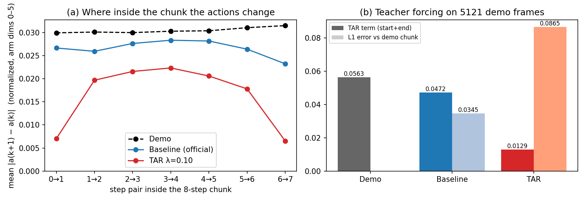

# TAR 课题：已完成实验盘点、相关文献调研与实验重规划

**日期**：2026-11-18（§4–§5 持续更新至 2026-11-21）  
**作者**：何宁秋  
**分页讲解（配图）**：[20261119-实验进度与讲解.md](20261119-实验进度与讲解.md)  
**承接文档**：[20261022-TAR方法说明与重构实验计划.md](20261022-TAR方法说明与重构实验计划.md)（方法、公式、指标定义、全部原始数据均以该报告为准，本报告不再重复）、[20261022-seed验证与统计复核进度报告.md](20261022-seed验证与统计复核进度报告.md)  
**本报告做三件事**：

1. **§1 盘点**：到今天为止真正完成了哪些实验，10-22 计划的执行情况，以及盘点中发现的遗留问题；
2. **§2 文献**：围绕"chunk 连续性 / 动作平滑 / 执行视界 / 评测统计"做的一轮文献调研，以及它们对本课题结论和定位的影响；
3. **§3 重规划**：结合"当前只有 1 张 GPU"的现实和文献启示，重新排定后续实验。

---

## 0. 一页摘要

1. **10-22 之后没有新增任何实验**。核对 `runs/`、`logs/`、`eval_logs/` 后确认：最后一次运行是 10-22 晚的单卡训练冒烟测试（第一次 `optimizer.step()` 时 OOM）。10-22 计划中的阶段 0（D1–D7）与阶段 A/B/C **均未开始**，D4 所需的代码开关（保存原始 chunk、temporal ensembling、屏蔽夹爪等）**也还没写**。根本原因是一直只有 1 张 4090D，而原计划的主体依赖 4 卡训练。
2. **当前全部可用证据仍是"一次 TAR 训练 vs 一个官方权重"**：成功率 88.4% vs 83.6%（+4.8 pp，McNemar p=0.025，配对 CI [+1.0, +8.8]）；chunk 内平滑度大幅改善（S1 −35%，MaxJump −50%），chunk 衔接跳变（IB）几乎未改善（−7.8%）。
3. **文献调研改变了三处判断**：
   - "推理侧方案都不适用于确定性回归头"**不再成立**：temporal ensembling、重叠线性混合（ChunkFlow 的执行部分）、运动基元的 via-point 条件化（arXiv 2610.39451）都能用于一次性输出的策略。贡献 C1 必须靠**实测对比**来支撑，不能只靠"适用性"论证；
   - **同类平滑正则在别处是负结果**：SmolVLA 上加速度/平滑惩罚使成功率崩溃、jerk 反增 3 倍（Frontiers 2026）。"为什么在 BitVLA（L1 回归头）上有效、在 SmolVLA（flow matching）上有害"本身是一个可写的分析点；
   - **执行视界（每个 chunk 执行几步）对成功率的影响呈倒 U 形且依赖 checkpoint**（AutoHorizon、PACE、Reactive-VLA 等多篇）。原计划只测"8→4"一个点不够，需要扫描；而且**用不同执行视界做评测，就能在不重训的情况下检验"TAR 是否依赖 chunk 边界"**。
4. **论文草稿与最新数据不一致**，需要修改：related work 中"TAR 在训练时消除边界跳变""首个发现……"的说法与 F4 及 ChunkFlow 等文献冲突；消融表仍用无法复现的历史数字；一条 bib 的作者信息有误（§1.4）。
5. **新计划按资源拆成两条线**：
   - **轨道 1（单卡，现在就做，约 2.5～3 周）**：代码补齐 → teacher-forcing 诊断 → 带原始数据重评 → 执行视界扫描 → 推理侧平滑对比 → 失败模式自动分类 → LIBERO-Plus 鲁棒性评测（只评测、不训练）→ 单卡训练可行性测试；
   - **轨道 2（4 卡，申请到资源后）**：阶段 A（多 seed，必做）→ 阶段 B（机理，变体按轨道 1 结果裁剪）→ 阶段 C（λ 扫描）→ 阶段 D（泛化）。最小可发表证据包仍约 7 次训练（≈350 h 4 卡墙钟）。

6. **11-18～11-20 轨道 1 评测队列已跑完（详见 §4、§5）**：`logs/track1/done.txt` **22/22**，`logs/track1_queue.out` 于 **2026-11-20 20:55** 记录 `all jobs finished`。E3～E5（含 blend 全库与 TE 三任务筛选）均有落盘 EVAL / npz；**E6 失败分类、E7、E9 仍未启动**。

**需要导师决定的事**：① 4 卡资源何时能到位（决定轨道 2 能否在年内启动）；② 是否同意把 LIBERO-Plus 鲁棒性评测作为新的泛化证据（成本低，但需要另建评测环境）。

---

# 1. 已完成实验盘点

## 1.1 时间线

| 时间 | 事件 | 产出 / 状态 |
|---|---|---|
| 2026-03 ～ 05 | 历史实验：λ ∈ {0, 0.01, 0.05, 0.10} 消融，成功率 86.4 / 89.0 / 90.8 / 93.6% | checkpoint 已丢失、训练未设 seed、环境未对齐，**只作参考，不作结论依据** |
| 2026-09-29 | AutoDL 新环境部署 | 环境脚本 `scripts/setup_env_autodl.sh` 等 |
| 09-30 00:02 | 第一次启动 v4-tar01 训练 | 约第 50 步因终端 SIGHUP 终止 |
| 09-30 11:10 → 10-02 13:24 | **v4-tar01 训练**（λ=0.10，4 卡 FSDP，10001 步，50.2 h） | `--10000_chkpt`、训练曲线 |
| 10-02 14:01 → 10-03 03:28 | **TAR 评测**（LIBERO-10，500 episodes） | 442/500 = **88.4%** |
| 10-03 07:19 → 20:35 | **Baseline 评测**（官方 `ft-bitvla-libero-long`，同环境） | 418/500 = **83.6%** |
| 10-03 ～ 10-07 | 云复现验收报告 | [20261003-云复现验收报告.md](20261003-云复现验收报告.md) |
| 10-22 | 零成本统计复核（Wilson / McNemar / 配对 bootstrap） | p = 0.025，CI [+1.0, +8.8] pp |
| 10-22 | 示教参照基准（379 条示教） | `report/data/demo_reference_stats.json` |
| 10-22 19:44 | **分片评测一致性验证**（Task 5，50 trials） | 与原评测 50/50 逐个一致，评测是确定性的 |
| 10-22 20:49 | **单卡训练冒烟测试**（`--seed 1`） | seed 路径正常；第一次 `optimizer.step()` OOM |
| 10-23 | 10-22 报告定稿（阶段 0 与 TE 说明） | 最后一次提交 `081c478` |
| **10-23 → 11-18** | **无新增实验** | 已核对：`runs/`、`logs/`、`eval_logs/` 中无 10-22 之后的文件；GPU 空闲 |

## 1.2 核心数据速览（详见 10-22 报告 §2）

| | Baseline（官方权重） | TAR λ=0.10（v4-tar01） | 示教参照 |
|---|---|---|---|
| 成功率 | 83.6% [80.1, 86.6] | **88.4%** [85.3, 90.9] | — |
| 失败数（全部为超时） | 82 | 58 | — |
| 成功 episode 平均 chunk 数 | 31.6 | 32.9 | — |
| S1（chunk 内平均变化） | 0.0155 | **0.0101** | 0.0159 |
| MaxJump | 0.1629 | **0.0810** | 0.1718 |
| IB（chunk 衔接跳变） | 0.0485 | 0.0447 | 0.0161 |
| IB / S1 | 3.1 | 4.4 | 1.0 |

一句话：**TAR 让 chunk 内部比人类示教还平滑，成功率更高，但 chunk 之间的接缝基本没变**；收益体现为"更少超时"，而不是"完成更快"。

## 1.3 10-22 计划的执行情况

| 编号 | 内容 | 资源 | 状态 | 说明 |
|---|---|---|---|---|
| D1 | teacher-forcing 诊断 | 1 GPU | ❌ 未开始 | 无阻塞，可立即做 |
| D2 | 带原始 chunk 的重评 | 1 GPU | ❌ 未开始 | 依赖 D4 的保存功能 |
| D3 | 失败录像抽检 | 人工 | ❌ 未开始 | 1057 个 MP4 已在 `openvla-oft/rollouts/`（未纳入 git） |
| D4 | 代码开关 | 无 | ❌ **未写** | 已核对：eval 只有 `num_open_loop_steps`，无原始 chunk 保存 / TE；训练只有 `tar_lambda` 与 `seed`，无屏蔽夹爪 / 全 chunk 惩罚 / 示教平滑 |
| D5 | 文档修正 | 无 | ⚠️ 部分 | 历史表格疑点已在 10-22 报告中指出，论文草稿未改（§1.4） |
| D6 | temporal ensembling 对比 | 1 GPU | ❌ 未开始 | 依赖 D4 |
| D7 | 开环步数 8→4 | 1 GPU | ❌ 未开始 | 参数已有，可立即做 |
| 4 卡 smoke test | FSDP 下 seed 行为 | 4 GPU | ❌ 未开始 | 无 4 卡 |
| 阶段 A / B / C / D | 多 seed、机理、λ、泛化 | 4 GPU | ❌ 未开始 | 无 4 卡 |

**反思**：原计划的阶段 0 本来就只需要 1 张 GPU，却在 4 周里没有推进，主要是因为阶段 0 被当成"等 4 卡期间顺手做的事"。新计划（§3）把单卡能做的实验列为**独立的主线**，并给出了逐周排期。

## 1.4 盘点中发现的遗留问题

| # | 问题 | 位置 | 处理建议 |
|---|---|---|---|
| I1 | related work 写"eliminating boundary jumps at training time""TAR is the first to identify … and close it with a targeted boundary-velocity regularizer" | `doc/paper/sections/related_work.tex` | 与 F4（IB 仅 −7.8%）矛盾；ChunkFlow（2026-07）已提出训练期 seam 损失 + 一/二阶连续性损失，"首个"不成立。**必须改写** |
| I2 | 消融表、正文使用历史数字（86.4 / 89.0 / 90.8 / 93.6），并写"baseline 是 λ=0 重训" | `tables/table4_ablation.tex`、`sections/experiments.tex` | 历史 checkpoint 已丢失，baseline 实际是官方权重。改用 10 月数据，待阶段 A/C 完成后替换 |
| I3 | 正文用"训练 loss 更高但成功率更高"论证"正则防过拟合" | `sections/experiments.tex` 第 62 行 | 0.085 是单步值（末 1000 步均值 0.0919），且没有 λ=0 同 recipe 的训练曲线，该论证目前无依据，建议删除或待 A3 后再写 |
| I4 | 比较表声称 TE "Degrades reactivity: Yes"、TAR "No" | `tables/table6_comparison.tex` | 未经实验验证；E5 完成后用实测填写 |
| I5 | bib 条目 `marino2024gradient` 作者错误 | `references.bib` | 实为 Lee, Cao, Dao, Chen, Wu（NYCU），Grad-CAPS（见 §2 [R10]） |
| I6 | baseline 历史总成功率 86.4% 与逐任务表平均 84.0% 不一致 | `20260418-实验报告.md` | 已在 10-22 报告指出，仍未核实；由于历史数据不再作结论依据，建议在论文中不再引用 |
| I7 | MuJoCo 两次报 `Nan, Inf or huge value in QACC at DOF 9`（10-02、10-03） | `openvla-oft/MUJOCO_LOG.TXT` | 发生在 smoke/评测期间，次数极少；E3 重评时记录是否复现，若影响某个 episode 应在统计时标注 |

---

# 2. 相关文献调研

**核对程度说明**：标 ✅ 的已阅读摘要和正文关键段落（数据摘自原文）；标 ◐ 的只核对了摘要。所有条目在写入论文前都应通读全文。

## 2.1 文献总表

### A. 推理侧：跨 chunk 连续性

| # | 工作 | 做法 | 关键数据 | 与本课题的关系 | 核对 |
|---|---|---|---|---|---|
| R1 | **ACT temporal ensembling**（Zhao et al., RSS 2023） | 每步都查询策略，对同一时刻的多个预测按 $e^{-m i}$ 加权平均 | — | 适用于确定性回归头；推理次数 ≈ chunk 长度倍 | 已在草稿中 |
| R2 | **BID**（Liu et al., arXiv [2408.17355](https://arxiv.org/abs/2408.17355)） | 每步采样多个候选 chunk，按"与上一决策一致 + 接近强策略"选择 | 7 个仿真基准 + 2 个真机任务提升 | 依赖采样，**不适用**于确定性 L1 头（只能出一个候选） | ✅ |
| R3 | **RTC**（Black, Galliker, Levine, NeurIPS 2025，[2506.07339](https://arxiv.org/abs/2506.07339)） | 异步执行；冻结已执行的前缀，用 inpainting 补全其余 | 真机 6 任务、Kinetix 12 任务，对延迟鲁棒 | 只适用于 diffusion/flow；结论"同步执行在 chunk 间有停顿与跳变"可引用 | ✅ |
| R4 | **SEAM**（Zhan et al., [2607.04609](https://arxiv.org/abs/2607.04609)） | 用上一 chunk 未执行的尾部，在 flow 去噪每步做闭式修正 | **LIBERO-10 + π0.5**：边界 jerk 是内部 jerk 的 2 倍以上（0.195 vs 0.094）；SEAM 边界 jerk −28%，成功率 95.7 vs 94.8；**ACT-TE 平滑最强（边界 jerk −84%）但成功率降到 82.7%** | ① 同基准上"边界跳变是主要不平滑来源"的独立证据；② TE 可能**伤害成功率**，D6/E5 的结果并不一定有利于 TE | ✅ |
| R5 | **FreeBar**（[2610.14997](https://arxiv.org/abs/2610.14997)） | 把相邻 chunk 对齐写成类 CBF 约束，闭式修正 | — | 面向 flow 策略的异步执行，不直接适用 | ◐ |
| R6 | **运动基元表示的平滑 chunk**（Nomura, Osa, et al., [2610.39451](https://arxiv.org/abs/2610.39451)） | 用平滑基函数的线性组合表示 chunk；推理时让新 chunk 经过上一 chunk 最后一步（via-point，闭式） | 一次性输出的 ACT：chunk 内 jerk 降一个数量级；via-point 条件化消除 **73–84%** 的边界不连续；成功率统计上不劣于原方法 | **最需要正视的竞争工作**：明确面向"一次性查询"的策略（与 BitVLA 同类），同时解决 chunk 内和 chunk 间。但它需要改输出表示并重训 | ✅ |

### B. 训练侧：连续性 / 平滑正则

| # | 工作 | 做法 | 关键数据 | 与本课题的关系 | 核对 |
|---|---|---|---|---|---|
| R7 | **Training-time RTC**（[2512.05964](https://arxiv.org/abs/2512.05964)） | 训练时模拟延迟，以真实动作前缀为条件预测后缀 | π0.6 真机与推理时 RTC 持平，零推理开销 | "几行代码、训练期、零推理开销"的叙事与 TAR 相同，但解决的是延迟而非平滑 | ✅ |
| R8 | **Legato**（Liu et al., [2602.12978](https://arxiv.org/abs/2602.12978)） | 训练期让 flow 策略学会"接续"已知动作 | 真机 5 任务，平滑度与完成时间约改善 10%；**更少犹豫** | 指出"不连续会造成犹豫、拉长完成时间"，与 F2/F8 的"超时"现象可对照 | ✅ |
| R9 | **ChunkFlow**（Yang et al., [2607.12992](https://arxiv.org/abs/2607.12992)） | 训练：seam 损失（相邻 chunk 重叠区 L2）+ 一阶 TV（L1）+ 二阶曲率（L2）；执行：重叠区线性混合；另加历史扰动与 AWAC | LIBERO-Long 93.4%；报告 π0.5+RTC 成功率降到 83.7% | **与 TAR 最接近**：它的一阶 TV 项 ≈ 本计划的 B1（全 chunk 速度惩罚）。TAR 只惩罚首尾两步，是其子集。另外，它的"重叠线性混合"不需要重训，可作为推理侧基线（E5） | ✅ |
| R10 | **CAPS**（Mysore et al., ICRA 2021，[2012.06644](https://arxiv.org/abs/2012.06644)）与 **Grad-CAPS**（Lee, Cao, Dao, Chen, Wu，[2407.04315](https://arxiv.org/abs/2407.04315)） | CAPS：惩罚相邻动作差（时间）+ 邻近状态动作差（空间）。Grad-CAPS：改为惩罚"动作变化量的变化"（二阶），并按位移归一化 | Grad-CAPS 指出 CAPS 这类一阶惩罚会**过度平滑**、损失敏捷性 | ① TAR 惩罚的正是一阶差，F3"比示教还平滑"与 Grad-CAPS 的过平滑担忧一致；② CAPS 的"空间平滑提升鲁棒性"假设可用 LIBERO-Plus 检验（E7） | ✅ |
| R11 | **SmolVLA 平滑正则负结果**（He, Frontiers in Neurorobotics 2026，[doi:10.3389/fnbot.2026.1890245](https://www.frontiersin.org/journals/neurorobotics/articles/10.3389/fnbot.2026.1890245/full)） | SmolVLA + LoRA，加平滑惩罚与 chunk 感知辅助损失，30K 步（原 recipe 的 1/67），3 seed × 500 episodes | 平滑惩罚使四套件宏平均 10.9% → 3.5%；**执行轨迹 jerk 反而增至 3 倍**（1.69 vs 0.59 RMS）；**夹爪维度占平滑惩罚约 28%**，屏蔽夹爪只恢复一部分；**TE 让成功率翻倍**（Spatial 19.0 → 36.2%） | ① 同类方法的反例，论文必须讨论"为什么本课题结论相反"；② 再次指出夹爪维度隐患（支撑 B2）；③ 其评测协议（3 seed、500 episodes/格、执行动作日志、预注册主比较）可作为本课题协议的模板 | ✅ |

### C. 表示侧：用平滑参数化"天然"保证平滑

| # | 工作 | 做法 | 与本课题的关系 | 核对 |
|---|---|---|---|---|
| R12 | **BEAST**（Zhou et al., NeurIPS 2025，[2506.06072](https://arxiv.org/abs/2506.06072)） | 用 B 样条控制点编码 chunk；夹紧样条让下一个 chunk 的首个控制点等于上一 chunk 最后一个动作；夹爪可用 0 阶样条 | 代表"改表示"路线，需要改动作头；可在相关工作中作为对照，不建议本课题复现 | ✅ |
| R6 | 运动基元表示（见上） | 同上 | 同上 | ✅ |

### D. 执行视界（每个 chunk 执行几步）

| # | 工作 | 关键结论 | 与本课题的关系 | 核对 |
|---|---|---|---|---|
| R13 | **AutoHorizon / VLA Knows Its Limits**（Wang et al., [2602.21445](https://arxiv.org/abs/2602.21445)） | π0.5 在 LIBERO 上，成功率随执行视界**先升后降**（倒 U） | D7 只测一个点不够，应扫描 | ✅ |
| R14 | **PACE**（Nie et al., [2606.00537](https://arxiv.org/abs/2606.00537)） | 在预测轨迹的**低速谷**处重新规划；RoboTwin2.0 成功率 57.8 → 64.2%，LIBERO（GR00T N1.7）最好 | 提示"在哪里切换 chunk"本身影响成功率，可作为 TAR 机理的参照 | ✅ |
| R15 | **DEHP**（[2606.11408](https://arxiv.org/abs/2606.11408)） | 用 RL 学习何时重新规划 | 相关工作 | ◐ |
| R16 | **Revisiting Open-Loop Execution**（Zeng, …, Tedrake, [2608.15938](https://arxiv.org/abs/2608.15938)） | 长开环执行主要帮助短上下文策略模仿"非马尔可夫示教"，而非减少累积误差；上下文足够长时闭环最好 | 为"为什么 chunk 执行 8 步有效、TAR 改变了什么"提供理论视角 | ✅ |
| R17 | **What Makes a VLA Reactive?**（Li, …, Lioutikov, [2611.15491](https://arxiv.org/abs/2611.15491)） | 最佳执行视界依赖 checkpoint；**保持轨迹连续的方法优于只降延迟的方法**；建议报告成功率时同时报告 chunk 连续性 | 支持把"连续性指标"作为评测协议一部分（贡献 C3）；"依赖 checkpoint"意味着比较 baseline 与 TAR 时应在多个视界下比 | ✅ |

### E. 评测、统计与鲁棒性基准

| # | 工作 | 关键结论 | 与本课题的关系 | 核对 |
|---|---|---|---|---|
| R18 | **Robot Learning as an Empirical Science**（Kress-Gazit et al., [2409.09491](https://arxiv.org/abs/2409.09491)） | 成功率之外应报告补充指标、统计分析、失败模式的定性描述 | 支撑 E6（失败分类）与统计协议 | ◐ |
| R19 | **Is Your Imitation Learning Policy Better than Mine?**（RSS 2025，[doi:10.15607/RSS.2025.XXI.077](https://doi.org/10.15607/rss.2025.xxi.077)） | 小样本下的序贯检验，可减少多达 32% 的评测 trial | 可选：以后评测成本吃紧时使用 | ◐ |
| R20 | **rliable / Deep RL at the Edge of the Statistical Precipice**（Agarwal et al., NeurIPS 2021） | 少量 seed 时报告区间估计、IQM，避免只报均值 | 阶段 A 的报告方式；**Wilson 区间只描述"这一个模型"，不能当作"方法"的不确定性** | 未重新核对（经典文献） |
| R21 | **LIBERO-Plus**（[sylvestf/LIBERO-plus](https://github.com/sylvestf/LIBERO-plus)） | 7 类扰动（相机、机器人初始状态、语言、光照、背景、传感器噪声、布局），共 10,030 个任务，含 LIBERO-10 的扰动版本（2,519 个）；OpenVLA-OFT 总分 69.6%，相机与初始状态扰动下降最大；可 `pip install -e .` 直接替换 `libero` | **只评测、不训练**的泛化证据：检验"更平滑的策略是否更鲁棒"（E7） | ✅ |
| R22 | **LIBERO-PRO**（[2510.03827](https://arxiv.org/abs/2510.03827)） | 标准 LIBERO 存在"记忆动作序列"问题，扰动后成功率可降到 0 | 提醒：LIBERO-10 上的高成功率不等于真实能力，论文讨论中应提及 | ✅ |

## 2.2 对本课题的五点启示

**L1. "推理侧方案对我们不适用"这一论证要收窄。**
RTC、SEAM、FreeBar、BID 确实依赖 flow/diffusion 或采样，对 BitVLA 的确定性 L1 头不适用。但以下三种对一次性输出的策略**同样可用**：temporal ensembling（R1）、重叠区线性混合（R9 的执行部分，需要"预测 8 步、只执行少于 8 步"）、运动基元 via-point（R6，但要改表示并重训）。因此贡献 C1 应改写为"**在可用于确定性回归头的方案中，TAR 是唯一零推理开销、不改模型结构的**"，并且必须有 E5 的实测对比来支撑。

**L2. 平滑正则的效果强烈依赖设置，需要解释"为什么这次有效"。**
同样惩罚相邻动作差，在 SmolVLA（flow matching、LoRA、1/67 训练预算）上有害（R11），在本课题（L1 回归头、全参数微调、完整 10K 步）上有益。可检验的差异有三个：① **输出头类型**：L1 回归本身倾向输出"条件中位数"，比 flow 采样更平滑，正则的"推力"方向可能不同；② **夹爪占比**：R11 中夹爪占平滑惩罚约 28%，本课题在 D1/E2 中可以算出同一比例；③ **训练预算**。这能形成论文讨论部分的一个小节（新贡献 C4，见 §2.3），**大部分只需诊断、不需要重训**。

**L3. 过度平滑是真实风险。**
Grad-CAPS（R10）指出一阶惩罚会损失敏捷性；本课题 TAR 的 S1 已是示教的 0.63×，MaxJump 0.47×；F8 显示 TAR 的失败 episode 动作更小（可能在"犹豫"）。所以：① λ 扫描（阶段 C）必须包含更大的 λ，找到拐点；② 若出现拐点，可加一个**二阶变体**（B6：只惩罚首尾的"变化量的变化"），作为对过平滑的修正。

**L4. 执行视界是一个零训练成本的机理探针。**
文献显示最佳执行视界依赖 checkpoint（R13、R17）。TAR 只约束每个 chunk 的**第 0→1 步和第 6→7 步**。如果把执行视界改为 4 或 2，执行到的片段末端就不再是被 TAR 约束过的那一步：
- 若 TAR 的优势在视界 4、2 下**依然存在** → 收益来自"整体更平滑"，与"边界"无关（支持 F3/F4 的解读，对应 B1）；
- 若优势**明显缩小** → 收益确实依赖"在被约束过的边界上切换 chunk"。

这个检验**只需要评测**，可以在拿到 4 卡之前回答 RQ2 的一部分，并决定 B1 是否值得训练。

**L5. 统计与评测协议要向近期规范看齐。**
① 方法层面的不确定性要用 **seed 层面**的区间（R20），当前的 Wilson 区间只描述单个模型；② 应保存**执行动作日志**并报告执行轨迹 jerk（R11、R17）；③ 应做**失败模式分类**（R18）；④ 可用 LIBERO-Plus（R21）在不训练的前提下补充泛化证据。

## 2.3 贡献定位（修订版）

| 贡献 | 10-22 版本 | 修订后 | 支撑实验 |
|---|---|---|---|
| **C1 适用场景** | "推理侧方案对确定性回归头不适用" | "在**可用于确定性回归头**的平滑方案中（TE、重叠混合、TAR），TAR 是唯一零推理开销、不改结构的；并用实测说明其成功率 / 平滑度 / 推理成本的权衡" | E5（新） |
| **C2 机理发现** | "收益来自比示教更平滑，而非修复边界" | 保留，并增加执行视界证据："TAR 的收益是否依赖 chunk 边界"由 E4 直接检验；"是否只是示教去噪"由 B3 检验 | E2、E4、B1、B3 |
| **C3 评测协议** | 示教参照 + 执行轨迹 jerk | 增加 SEAM 式"边界 jerk vs 内部 jerk"分解、失败模式自动分类，以及多执行视界下的比较 | E1、E3、E6 |
| **C4 适用条件（新）** | — | "动作平滑正则何时有效"：与 SmolVLA 负结果对照，量化夹爪占比、输出头类型、训练预算的作用 | E2（夹爪占比）、B2、讨论 |

**结论**：方法本身仍然是"一个几行代码的损失项"，新颖性有限，这一判断不变。论文价值主要来自 **C2 + C4（解释清楚为什么有效、什么时候有效）** 以及 **C1 的实测对比**。任何"首个""消除边界跳变"的说法都应删去。

---

# 3. 重规划后的实验计划

## 3.1 与 10-22 计划相比的主要变化

| 变化 | 原因 |
|---|---|
| 按资源拆成**轨道 1（单卡，立即开始，有逐周排期）**和**轨道 2（4 卡，资源到位后）** | 过去 4 周阶段 0 未推进；单卡实验不应依附于 4 卡计划 |
| D7 从"8→4 一个点"改为**执行视界扫描 {2, 4, 8}**，并赋予机理检验的作用（H2） | L4；文献显示视界影响非单调 |
| D6 扩展为**推理侧平滑对比**：TE + 重叠线性混合 | L1；混合方案成本远低于 TE |
| 新增 **E6 失败模式自动分类**、**E7 LIBERO-Plus 鲁棒性评测**、**E8 单卡训练可行性** | L5；单卡资源下增加证据 |
| 阶段 B 新增可选的 **B6 二阶变体**；B4（跨 chunk 损失）继续后置 | L3；B4 与 ChunkFlow 重叠 |
| 新增**论文修改**作为一项正式任务 | §1.4 |

## 3.2 要检验的假设

| 编号 | 假设 | 若成立 | 若不成立 | 检验 |
|---|---|---|---|---|
| **H1 稳健性** | TAR 相对同 recipe 的 λ=0，在不同 seed 下都有提升 | 主结论成立 | 结论降级（见 G1） | 阶段 A |
| **H2 边界依赖** | TAR 的收益依赖于"在被约束的 chunk 首尾处切换" | 保留"边界"表述 | 改述为"速度正则"，B1 优先 | **E4（只评测）**、B1 |
| **H3 过平滑 / 犹豫** | TAR 剩余的失败中"停滞"比例更高，λ 再大会使停滞增多 | 存在 λ 上限，需给出推荐区间；考虑 B6 | 过平滑不是问题 | E3、E6、阶段 C |
| **H4 推理侧替代** | TE 或重叠混合能在 baseline 上达到与 TAR 相当的收益 | TAR 的卖点只剩"零开销"；检验二者能否叠加 | C1 成立 | E5 |
| **H5 鲁棒性** | 更平滑的 TAR 在扰动下（初始状态、相机、噪声）退化更少 | 新增一条泛化证据 | 只报告为中性结果 | E7 |
| **H6 示教去噪** | TAR 的作用等价于"把示教动作平滑后再训练" | C2 改写 | TAR 有独立的正则效应 | B3 |
| **H7 夹爪** | 对夹爪维度施加 TAR 有害或无关 | 方法默认屏蔽夹爪 | 保留 7 维 | E2（占比）、B2 |

## 3.3 轨道 1：单卡实验（立即开始）

**资源**：1 × RTX 4090D（24GB），15 个 CPU 核，内存约 1 TB。评测以 OSMesa CPU 渲染为瓶颈，单卡建议同时跑 2 路（已验证两路各占约 7GB 显存可稳定运行），受 CPU 核数限制，3 路以上需要实测。

| 编号 | 实验 | 具体内容 | 成本（估） | 产出 / 回答的问题 |
|---|---|---|---|---|
| **E1** | **代码补齐**（原 D4） | **eval**：① 每个 episode 保存原始 chunk 与实际执行的动作（`npz`）；② 保存末端执行器位姿（用于停滞检测）；③ `--num_open_loop_steps` 支持 2/4/8；④ temporal ensembling 开关（每步查询，权重 $e^{-m i}$）；⑤ 重叠线性混合开关（预测 8 步、执行 $S$ 步，重叠区按 R9 线性过渡）；⑥ 新指标：执行轨迹 jerk、**边界 jerk / 内部 jerk**（SEAM 式）、GripperSw（0.5 阈值）。**训练**：⑦ 屏蔽夹爪；⑧ 全 chunk 速度惩罚；⑨ 示教时间轴低通平滑；⑩ 二阶首尾惩罚（B6） | 约 3～4 天 | 所有后续实验的前提。用 smoke（每任务 2 episode）验证；改动后的默认设置必须复现 v4-tar01 Task 5 的 46/50 |
| **E2** | **teacher-forcing 诊断**（原 D1） | baseline 与 TAR 权重在 5,000 个训练样本上前向：$\mathcal{L}_{\text{TAR}}$、S1、首尾变化量，并**按 6 个机械臂维度 / 夹爪拆分**，计算夹爪占 TAR 项的比例（与 R11 的 28% 对照）；同时计算 L1 误差 | 约 2 GPU·h | 回答 F5/G0；给出 H7 的初步证据（夹爪占比） |
| **E3** | **带原始数据重评**（原 D2） | baseline 与 TAR 各 500 episodes，视界 8，保存全部原始数据 | 约 26 GPU·h（2 路并行约 13 h 墙钟） | 验证确定性（应与 §1.2 完全一致）；为 E6 和论文轨迹图提供数据；IB 拆分到各维度 |
| **E4** | **执行视界扫描**（原 D7 扩展） | baseline 与 TAR × 视界 {4, 2}（视界 8 即 E3） | 4 组 × 500 episodes；推理次数为 2×/4×，约 70～90 GPU·h（**估，需实测**） | **H2**：见 L4 的判定规则；同时得到两个模型各自的最佳视界 |
| **E5** | **推理侧平滑对比**（原 D6 扩展） | ① baseline + TE；② TAR + TE；③ baseline + 重叠混合（执行 4、重叠 4）；④ TAR + 重叠混合。记录成功率、执行 jerk、每 episode 推理次数与墙钟时间 | TE 每步查询，推理次数约 8×，约 30～40 GPU·h/组；混合约同 E4 的视界 4。合计约 100～130 GPU·h（估） | **H4 / C1**。可先只跑 TE 的 3 个任务（Task 5、7、9，150 episodes）做筛选，差异明显再补全 |
| **E6** | **失败模式自动分类**（原 D3 升级） | 基于 E3 的 npz 与位姿：定义"停滞"（末端速度低于阈值连续 N 步）、"反复抓取"（夹爪多次开合但物体未抬起）、"放错位置"等；每类人工抽检 MP4 校准阈值 | CPU + 人工约 2 天 | **H3**；解释 F8 与 Task 7 的不稳定 |
| **E7** | **LIBERO-Plus 鲁棒性评测**（新） | 在**独立 conda 环境**中安装 LIBERO-Plus，选 LIBERO-10 的 3 类扰动：机器人初始状态、相机视角、传感器噪声；每类抽 100 个扰动任务 × 2 个模型 | 环境搭建约 1 天；评测约 600 episodes ≈ 10～15 GPU·h（估） | **H5**；不需要训练的泛化证据。注意：需要确认扰动版本的 episode 预算与原版一致 |
| **E8** | **单卡训练可行性**（新） | 在 1 卡上试 ① FSDP 优化器状态 CPU offload（内存 1 TB 足够）；② 代码已有的 `use_lora` 路径。各跑 50 步，记录显存与秒/步 | 约 0.5 天 | 若单卡步速可接受（例如 ≤ 4 卡墙钟的 4～5 倍），可在等 4 卡期间先跑**缩短版**的 B 阶段筛选；否则明确"训练必须等 4 卡" |
| **E9** | **论文与文档修正**（原 D5 扩展） | 处理 §1.4 的 I1–I6；按 §2 补充参考文献；related work 重写为"推理侧 / 训练侧 / 表示侧 / 执行视界"四段 | 约 2 天 | 避免旧口径继续扩散 |

**轨道 1 总成本**：约 210～260 GPU·h（主要是 E4、E5），单卡 2 路并行约 **5～6 天纯评测墙钟**；加上代码和分析，约 **2.5～3 周**。若时间紧，E5 先做筛选版（-70 GPU·h）。

**轨道 1 内部的判定**（为轨道 2 裁剪变体）：

| 轨道 1 结果 | 对轨道 2 的影响 |
|---|---|
| E2：baseline 的 TAR 值本来就接近 0.0132 | TAR 项可能不是主因，B3（示教去噪）优先级上升 |
| E2：夹爪占 TAR 项比例很高（如 > 20%） | B2 优先做 |
| E4：TAR 优势在视界 4/2 下保持 | H2 不成立 → B1 优先，表述改为"速度正则" |
| E4：TAR 优势在视界 4/2 下消失 | H2 成立 → 保留"边界"表述，B1 降级 |
| E5：TE 或混合在 baseline 上的收益 ≥ TAR | C1 弱化为"零开销"；检验 TAR + TE 是否叠加；考虑把 B4 提前 |
| E5：TE 降低成功率（类似 R4 的 94.8→82.7） | C1 加强，B4 保持后置 |
| E6：TAR 剩余失败以"停滞"为主 | 阶段 C 必须包含 λ = 0.2、0.5；考虑 B6 |
| E8：单卡可行 | B 阶段先用单卡跑缩短版筛选（如 5K 步），4 卡只跑最终配置 |

## 3.4 轨道 2：4 卡训练实验（资源到位后）

成本记号：训练 1 次 = 4 卡约 50 h（实测 18.06 s/步 × 10001 步）；评测 1 次 = 约 13 GPU·h / 500 episodes。

### 阶段 A：稳健性（H1）——必做，最先做

| 编号 | 训练 | seed |
|---|---|---|
| A0 | 4 卡 100 步 smoke test：确认 FSDP 下各卡 batch 不同、seed 生效 | 1 |
| A1 / A2 | TAR λ=0.10 | 1 / 2 |
| A3 / A4 | 对照 λ=0（同 recipe 重训） | 1 / 2 |
| A5 / A6（建议） | TAR λ=0.10 / λ=0 | 3 / 3 |

- **最小版**：A1 + A2 + A3（约 150 h）。**推荐版**：A1–A4（约 200 h）。**有余力**：加 A5/A6，达到每臂 3 个 seed，可以报告 seed 层面的区间（R20），也与 R11 的 3-seed 协议对齐。
- 每个 run 评测时同时做视界 8 与 E4 中表现最好的视界（若与 8 不同），以检验"结论不依赖执行视界"。
- **门槛 G1**（沿用 10-22）：每个 seed 的 TAR 都高于同 seed 的 λ=0，且平均差 ≥ +2 pp → 通过；方向一致但 < 2 pp → 降级表述；多数 seed 无提升 → 转向机理与平滑度本身的价值。

### 阶段 B：机理（H2、H6、H7）——按轨道 1 结果裁剪

在 seed=1、λ=0.10 下各训 1 次，与 A1/A3 对比：

| 编号 | 变体 | 检验 | 优先级由谁决定 |
|---|---|---|---|
| B1 | 全 chunk 一阶速度惩罚（≈ ChunkFlow 的 TV 项） | H2 | E4 |
| B2 | TAR 屏蔽夹爪 | H7 | E2 |
| B3 | 示教低通平滑（λ=0），使示教 S1 降到约 0.6× | H6 | E2 |
| B6（可选，新） | 首尾**二阶**惩罚：$\lvert\hat a_2-2\hat a_1+\hat a_0\rvert+\lvert\hat a_{T-1}-2\hat a_{T-2}+\hat a_{T-3}\rvert$ | H3（过平滑） | E6、阶段 C |
| B4（后置） | 跨 chunk 衔接损失 | — | 仅当 E5 显示"抹平接缝"能明显提升成功率 |
| B5（最低） | 只惩罚起步 / 只惩罚收尾 | — | — |

- **预计 B 阶段实际只需 2～3 次训练**（轨道 1 会排除部分变体），约 100～150 h。
- **门槛 G2**（沿用）：B1 ≥ TAR → 改述为"速度正则"；B2 ≥ TAR → 默认屏蔽夹爪；B3 ≈ TAR → C2 改写为"示教平滑"；都不优于 TAR → 保留现形式。

### 阶段 C：λ 敏感性

| 编号 | λ |
|---|---|
| C1 | 0.05 |
| C2 | 0.20 |
| C3 | 0.50 |

- 与 A 阶段的 λ = 0、0.10 构成 5 点曲线；以平滑度指标（噪声小）+ 成功率趋势 + **停滞比例**（E6 的分类器）为主，以 G1 中 seed 间的波动作为"有差异"的尺度。
- 若 λ=0.5 出现明显过平滑（停滞增多、成功率下降），则 B6 值得做。
- 成本约 150 h。

### 阶段 D：泛化

| 编号 | 实验 | 说明 |
|---|---|---|
| D-0（已移入轨道 1） | LIBERO-Plus 扰动评测 | E7，无需训练 |
| D-a | LIBERO-Spatial 上 λ=0 vs 最终形式，各 1 次 | 任务短，作 pilot；先核实官方是否提供该 suite 的 BitVLA 权重 |
| D-b | LIBERO-Object / Goal | 视 D-a 结果 |
| D-c | 其它模型 | 优先考虑也使用 L1 回归头的 OpenVLA-OFT（同代码库），但 7B 在 24GB 卡上全参数微调大概率不可行，需要 LoRA 版本；flow 类模型（SmolVLA）可用于直接对照 R11，但工程量大，放最后 |

- **门槛 G3**：Spatial pilot 中 TAR 不退步（Δ ≥ 0）且平滑度同向改善，才继续扩展。

### 阶段 E：长期

真机验证、自适应 λ、与执行视界自适应方法（R14 PACE）的结合。依赖实验室资源，不纳入近期排期。

## 3.5 优先级与资源汇总

| 优先级 | 内容 | 训练次数 | 4 卡墙钟 | 评测 GPU·h | 前提 |
|---|---|---|---|---|---|
| **P0（现在）** | 轨道 1：E1–E9 | 0 | 0 | 约 210～260 | 1 卡 |
| **P1（必做）** | 阶段 A（推荐版 A1–A4） | 4 | 约 200 h | 约 52～80（含第二视界） | 4 卡 |
| **P1（强烈建议）** | 阶段 B（裁剪后 2～3 个变体） | 2～3 | 约 100～150 h | 约 26～39 | G1 通过 |
| P2 | 阶段 C | 3 | 约 150 h | 约 39 | G2 |
| P2 | 阶段 D-a | 2 | 约 100 h（估） | 待估 | G2/G3 |
| P3 | A5/A6、B4/B5/B6、D-b/c、E | — | — | — | 视结果 |

- **最小可发表证据包**：轨道 1 + A（推荐版）+ B（裁剪后）：约 **6～7 次训练、约 300～350 h（约 13～15 天）4 卡墙钟**，评测合计约 300～380 GPU·h。
- **完整版**（再加 C、D-a）：约 11～12 次训练、约 550～600 h（约 23～25 天）。
- 训练串行时，上一次训练的评测可与下一次训练并行（训练卡之外再用 1 张卡做评测）。

## 3.6 排期（假设 4 卡在 12 月中旬到位）

```text
第 1 周（11-18 ～ 11-24）  E1 代码补齐 + smoke 验证；E2 诊断；E8 单卡可行性；E9 论文修正开始
第 2 周（11-25 ～ 12-01）  E3 重评（2 路并行）；E6 失败分类器（基于 E3 数据）；E7 环境搭建
第 3 周（12-02 ～ 12-08）  E4 视界扫描；E5 筛选版（Task 5/7/9）；E7 评测
第 4 周（12-09 ～ 12-15）  E5 补全（视筛选结果）；轨道 1 汇总报告 → 确定 B 阶段变体
4 卡到位后               A0 smoke → A1 → A3 → A2 → A4（约 8～9 天）
                          └─ G1 ─► B（2～3 个，约 4～6 天）─► G2 ─► C1～C3 ─► D-a ─► G3
```

- 若 4 卡更晚到位，轨道 1 结束后可按 E8 结果用单卡跑 B 阶段的缩短版筛选；若 E8 不可行，则把时间投入论文写作（related work、方法、轨道 1 的分析结果）。
- **A 阶段的 seed 数量比任何扩展都重要**，资源紧张时优先保证 A1–A3。

## 3.7 风险与应对

| 风险 | 影响 | 应对 |
|---|---|---|
| 4 卡迟迟不到位 | 主结论（H1）无法验证 | 轨道 1 先产出机理与对比证据；E8 争取单卡缩短版；与导师确认资源时间点 |
| E5 显示 TE / 混合在 baseline 上收益 ≥ TAR | C1 弱化 | 如实报告；检验 TAR + 推理侧方案是否叠加，强调"零开销" |
| G1 不通过 | 主结论降级 | 按决策树调整表述与投稿档次；论文转为"平滑正则适用条件"的分析型工作（C2 + C4） |
| 与 ChunkFlow、运动基元方法（R6）重叠 | 新颖性受质疑 | 不主张"首个"；明确 TAR 是其中最简单的特例，用"为什么有效、何时有效"的分析建立价值 |
| E1 改动破坏评测确定性 | 新旧数据不可比 | 改动后必须复现 Task 5 的 46/50 才能继续 |
| LIBERO-Plus 安装污染现有环境 | 主评测环境损坏 | 在独立 conda 环境中安装，不修改 `bitvla` 环境 |
| CPU 核数（15）限制评测并行 | 轨道 1 墙钟变长 | 先测 2 路、3 路的实际吞吐；必要时优先保证 E3、E4 |
| 原始数据体积大（每 episode 约 65 × 8 × 7 的 chunk + 520 步位姿，体积小；MP4 才是大头） | 磁盘紧张 | npz 全存；MP4 只保留失败 episode 与每任务 2 个成功样本 |

## 3.8 本周即可开始的具体任务清单

1. 在 `run_libero_eval_bitnet.py` 中让 `SmoothnessTracker` 把每个 episode 的原始 chunk、执行动作、末端位姿写入 `npz`（E1 ①②）。
2. 编写 `scripts/teacher_forcing_diag.py`（E2），输出 baseline / TAR 的首尾变化量与夹爪占比。
3. 试 FSDP CPU offload 单卡 50 步（E8）。
4. 修正 `references.bib` 中 Grad-CAPS 作者，并在 related work 中删除"首个""消除边界跳变"的表述（E9）。

---

# 4. 执行记录（2026-11-18 当天）

## 4.1 状态总览

| 编号 | 状态 | 结果 / 位置 |
|---|---|---|
| E1 代码补齐（评测侧） | ✅ 完成并验证 | `run_libero_eval_bitnet.py` 新增 `execution_mode`（chunk / te / blend）、`te_decay`、`save_raw_npz`；每个 episode 保存 `runs/eval_logs/<label>/raw/task<id>_ep<idx>.npz`（完整 8 步预测 chunk、查询时刻、执行动作、环境动作、末端位姿、夹爪位置）。分析脚本 `scripts/analyze_raw_evals.py` |
| E1 代码补齐（训练侧） | ⚠️ 部分 | 只加了 `fsdp_cpu_offload`（E8 需要）。屏蔽夹爪 / 全 chunk 惩罚 / 示教平滑 / 二阶变体留到训练前再写 |
| E2 teacher-forcing 诊断 | ✅ 完成 | `report/data/tf_diag_{base,tar}.{json,npz}`，图 `report/figures/fig5_tf_diag_profile.png`（§4.3） |
| E8 单卡训练可行性 | ✅ 完成 | 可行，约 20 s / 优化步（16 样本）（§4.4） |
| E3 重评 h=8 | 完成 | 与 10 月 83.6% / 88.4% 一致；500×2 npz（§5.1） |
| E4 开环视界 | 完成 | h=2/4/8 四模型各 500 局（§5.2） |
| E5 推理平滑 | 完成 | blend 各 500；TE Task 4/6/8 各 50×2（§5.3） |
| E6 失败分类 | 待启动 | E3～E5 npz 已齐；`analyze_raw_evals.py` |
| E7 LIBERO-Plus | 未开始 | 需另建 conda 环境 |
| E9 论文修正 | 未开始 | — |

## 4.2 E1 正确性验证

- **默认设置与旧代码逐位一致**：用改动后的代码重跑 v4-tar01 Task 5（id 4）前 3 个 episode，3 个 episode 的成败与 S1 / S2 / MaxJump / IB / GripperSw **与 10-22 分片评测的 JSON 逐位相同**（chunk 数 28 / 28 / 26）。因此后续 E3 结果可以直接与 10 月数据配对比较。
- **新模式冒烟**：blend（执行 4、重叠 4）1 个 episode 成功；TE（每步查询，$m=0.01$）1 个 episode 超时失败（520 步、520 次查询）。单个 episode 不作结论。
- 冒烟数据上的执行轨迹指标（仅作 sanity check，样本极少）：视界 8 时"重规划步的跳变 / 非重规划步的跳变"= 4.6（与 10-22 报告的 IB/S1 = 4.4 一致）；blend 降到 1.0；TE 的停滞比例 83%。

## 4.3 E2 结果：TAR 确实把 chunk 首尾"压平"了，但 baseline 的训练量是 TAR 的约 10 倍

在 379 条示教中每隔 20 帧取一帧（共 5,121 帧），把两个相机图像 + 状态 + 指令输入模型，与该帧起的示教 8 步 chunk 比较（归一化空间，与 TAR 损失同口径）：



| 指标（归一化空间） | 示教 | Baseline | TAR | TAR / Baseline |
|---|---|---|---|---|
| TAR 项（首 + 尾变化量，7 维平均） | 0.0563 | 0.0472 | **0.0129** | 0.27× |
| 起步变化 $\lvert a_1-a_0\rvert$ | 0.0276 | 0.0254 | 0.0067 | 0.26× |
| 收尾变化 $\lvert a_7-a_6\rvert$ | 0.0287 | 0.0218 | 0.0062 | 0.28× |
| chunk 中段变化（第 2→3、3→4 步，机械臂 6 维） | 0.030 | 0.028 | 0.022 | 0.79× |
| 夹爪占 TAR 项的比例 | 6.4% | 9.4% | 9.7% | — |
| **与示教 chunk 的 L1 误差** | — | **0.0345** | **0.0865** | 2.5× |

**结论**：

1. **G0 有了答案**：baseline 的 TAR 值（0.0472）接近示教（0.0563），TAR 模型降到 0.0129，**降幅约 73%**。所以 TAR 项确实在起作用，不是"L1 回归本来就平滑"。
2. **作用集中在首尾，不是整体压低**：图 (a) 中 baseline 与示教的曲线基本是平的；TAR 的曲线呈"倒 U 形"，首尾两步降到约 1/4，中段只降约 20%。也就是说，TAR 的形状效应**确实只在 chunk 边界**，这让 E4（执行视界扫描）对 H2 的检验更有意义：视界 4 / 2 时，执行片段的末端不再是被压平的那一步。
3. **夹爪占比只有约 10%**，远低于 SmolVLA 负结果中的 28%（R11）。**B2（屏蔽夹爪）的优先级下调**。
4. **新发现的混杂因素（需要写进论文局限）**：TAR 模型对训练示教的拟合误差是 baseline 的 2.5 倍（0.0865 vs 0.0345）。核对后发现官方 baseline 的权重文件名为 `action_head--100000_checkpoint.pt`、`proprio_projector--100000_checkpoint.pt`，**说明它训练了约 100K 步，而 TAR 只训练了 10K 步**（批大小未知）。因此"TAR vs 官方 baseline"同时混杂了：① 是否使用 TAR；② 训练量相差约 10 倍；③ DDP vs FSDP。baseline 对示教拟合得更紧，却成功率更低，这本身也可能说明"训练久了反而过拟合"，与 TAR 无关。**这使阶段 A 中同 recipe（10K 步）的 λ=0 对照（A3）成为整个结论的前提**，优先级高于其它一切实验。

## 4.4 E8 结果：单卡全参数训练可行

- 改动：`finetune_bitnet.py` 新增 `fsdp_cpu_offload`（FSDP `CPUOffload(offload_params=True)`），`train_tar.sh` 新增环境变量 `FSDP_CPU_OFFLOAD`、`GRAD_ACCUM`；启动脚本 `scripts/run_train_offload_1gpu.sh`。默认值不变，4 卡训练不受影响。
- 第一次尝试在反向传播时 OOM，原因是与 E2 同卡（E2 占 7GB），整模型梯度需一次性分配 5.25 GB；**独占 GPU 后成功**：4 个优化步（每步 8 × 2 = 16 个样本），稳定后约 **20 s / 步**。
- **换算**：与 4 卡 recipe 相同的有效批 64（`GRAD_ACCUM=32`），约 80 s / 步，10,001 步约 **220 h（约 9 天）**，是 4 卡（50 h）的约 4.4 倍。
- **含义**：如果 4 卡在 12 月中旬前无法到位，可以用单卡先跑 **A3（λ=0，seed 1，同 recipe 10K 步）**——它是 §4.3 第 4 点指出的最关键缺口。代价是单卡在这 9 天内不能同时做评测（训练约占 12～17 GB 显存）。注意：单卡 + offload 与 4 卡 FSDP 的数值不完全相同（批内样本组织不同），论文中需要说明，最好再用同样的单卡设置跑一个 λ=0.10，形成严格配对。

## 4.5 E3 / E4 / E5 评测队列

| 组 | 标签 | 内容 | episode 数 |
|---|---|---|---|
| E3 | `e3-tar-h8`、`e3-base-h8` | 视界 8 重评 + 原始数据 | 各 500 |
| E4 | `e4-{tar,base}-h4`、`e4-{tar,base}-h2` | 视界 4、2 | 各 500 |
| E5 | `e5-{tar,base}-blend4` | 执行 4、重叠 4 的线性混合 | 各 500 |
| E5 | `e5-{tar,base}-te` | TE 筛选：Task 5 / 7 / 9（id 4 / 6 / 8） | 各 150 |

- 每个 500-episode 评测拆成 2 个分片（奇偶任务），3 路并行；作业起始间隔 90 秒，避免并发加载模型时同时改写 checkpoint 的 `config.json`。
- 完成的作业记在 `logs/track1/done.txt`，中断后重启 `run_eval_queue.sh` 会自动跳过已完成的部分。
- **11-20 20:55 已全部结束**（墙钟约 2.2 天，自 11-18 16:25 起）。查看进度：`cat logs/track1_queue.out`；轨迹汇总：`python scripts/analyze_raw_evals.py e3-tar-h8 e3-base-h8 e4-tar-h4 e4-base-h4 e4-tar-h2 e4-base-h2 e5-tar-blend4 e5-base-blend4`。

## 4.6 资源与范围（记录用）

- **四卡**：A3 及阶段 A 是否与 v4-tar01 相同采用四卡分布式训练。
- **LIBERO-Plus（E7）**：是否纳入论文泛化部分（仅评测）。

---

# 5. 轨道 1 评测结果（2026-11-21 定稿：队列已结束）

队列 **`done.txt` 22/22**（2026-11-20 20:55）。复现统计：

```bash
python3 scripts/eval_stats.py 'runs/eval_logs/e3-base-h8/EVAL-*.txt' 'runs/eval_logs/e3-tar-h8/EVAL-*.txt'
python3 scripts/eval_stats.py 'runs/eval_logs/e4-base-h4/EVAL-*.txt' 'runs/eval_logs/e4-tar-h4/EVAL-*.txt'
python3 scripts/eval_stats.py 'runs/eval_logs/e4-base-h2/EVAL-*.txt' 'runs/eval_logs/e4-tar-h2/EVAL-*.txt'
python3 scripts/eval_stats.py 'runs/eval_logs/e5-base-blend4/EVAL-*.txt' 'runs/eval_logs/e5-tar-blend4/EVAL-*.txt'
python3 scripts/analyze_raw_evals.py e3-tar-h8 e3-base-h8 e4-tar-h4 e4-base-h4 e4-tar-h2 e4-base-h2 e5-tar-blend4 e5-base-blend4
```

部分轨迹汇总（早期导出）：`report/data/track1_e3_e4tar_h4_metrics.json`（完整标签请用上式重跑）。

## 5.1 E3（开环 8）：与 2026-10 云复现一致

| 模型 | 成功率 | Wilson 95% CI |
|------|--------|---------------|
| 官方 Baseline | **418/500 = 83.6%** | [80.1%, 86.6%] |
| TAR v4-tar01 | **442/500 = 88.4%** | [85.3%, 90.9%] |

配对（同任务、同初始状态）：差 **+4.8 pp**；McNemar **p = 0.025**；bootstrap 95% CI **[+1.0%, +8.8%]**。与 `python3 scripts/eval_stats.py --default` **总数与逐任务表一致** → 新评测管线未改坏主结论。

### 执行轨迹（npz）

| 指标 | Baseline h=8 | TAR h=8 |
|------|----------------|---------|
| exec_s1 | 0.0196 | **0.0144** |
| replan 步跳变 / 非 replan 步跳变 | 3.14 | **4.51** |
| stall_frac（失败局 / 成功局，TAR） | — | **0.47 / 0.09** |

失败仍以超时为主；失败局停滞比例高，供 E6 细分类。

## 5.2 E4：执行视界 8 / 4 / 2

### 配对成功率（各 500 局，同任务同初始状态）

| 开环步数 | Baseline | TAR | 配对差 | McNemar |
|----------|----------|-----|--------|---------|
| **8**（E3） | 83.6% | 88.4% | **+4.8 pp** | **0.025** |
| **4** | 75.0% | 80.2% | **+5.2 pp** | **0.045** |
| **2** | **62.8%** | **69.0%** | **+6.2 pp** | **0.019** |

视界缩短时两模型绝对成功率均下降，但 **TAR−Baseline 配对差未缩小**（8→4→2：**+4.8 → +5.2 → +6.2 pp**）。与「收益完全依赖在 chunk 首尾步上切换」的**朴素 H2**不一致；写机制段时宜结合 replan/int 比值（TAR 在 h=2 仍 **6.26** vs Baseline **1.43**）与失败停滞率，避免过度宣称。

### TAR 自身：固定权重下视界变短

| 开环 | TAR 成功率 | 相对 h=8 |
|------|------------|-----------|
| 8 | 88.4% | — |
| 4 | 80.2% | **−8.2 pp**（自配对 p≈0） |
| 2 | 69.0% | **−19.4 pp** |

### 轨迹摘要（`analyze_raw_evals.py`）

| 标签 | SR | exec_s1 | replan/int | stall_frac |
|------|-----|---------|------------|------------|
| e3-tar-h8 | 88.4% | 0.0144 | 4.51 | 0.135 |
| e3-base-h8 | 83.6% | 0.0196 | 3.14 | 0.139 |
| e4-tar-h4 | 80.2% | 0.0154 | 3.10 | 0.191 |
| e4-base-h4 | 75.0% | 0.0214 | 2.20 | 0.202 |
| e4-tar-h2 | 69.0% | 0.0131 | 6.26 | 0.273 |
| e4-base-h2 | 62.8% | 0.0194 | 1.43 | 0.274 |

## 5.3 E5：重叠混合与 TE 筛选

### 重叠混合（执行 4、重叠 4，全库 500 局）

| 模型 | chunk h=8（E3） | blend | 配对差（blend 500 局） |
|------|-----------------|-------|------------------------|
| Baseline | 83.6% | **84.2%** | — |
| TAR | 88.4% | **88.4%** | — |
| **TAR vs Baseline** | +4.8 pp | **+4.2 pp**，**p=0.033** | CI **[+0.6%, +7.8%]** |

Blend 对 **Baseline** 仅略升（+0.6 pp），对 **TAR** 与 chunk h=8 相同；**不能**用混合 alone 抹平训练 带来的差距。平滑：`e5-tar-blend4` replan/int **1.03**，jerk **0.016**（低于 chunk 开环）。

### 时间集成 TE（Task id **4 / 6 / 8** 各 50 局，每环境步查询）

| Task id | Baseline TE | TAR TE |
|---------|-------------|--------|
| 4 | **84%** (42/50) | **80%** (40/50) |
| 6 | **60%** (30/50) | **54%** (27/50) |
| 8 | **60%** (30/50) | **84%** (42/50) |
| **合计** | **68.0%** (102/150) | **72.7%** (109/150) |

TE 为**筛选协议**（非全库配对）；Task 6 两模型均偏低，Task 8 TAR 明显高于 Baseline。不宜在未做同初始状态配对前写 TE「整体优于 chunk」；与 SEAM 等「TE 可能伤成功率」的叙述一致，**C1 仍强调 TAR 零额外推理开销**，E5 支撑对比段落而非替代 A3。

## 5.4 与假设、轨道 2 裁剪的对应

| 假设 / 决策点 | 当前证据 |
|---------------|----------|
| 评测可复现 | E3 与 10 月一致 |
| TAR 训练压首尾（E2） | 示教前向 + E3～E4 成功率 |
| H2（边界 vs 视界） | 配对差随 h 缩短**未缩小**；TAR 自配对随 h 大幅下降 |
| H4（推理侧替代） | Blend 未让 Baseline 追上 TAR；TAR 上 blend **无增益** |
| B 阶段裁剪 | E2 已降 **B2**；E5 未支持立刻做 **B4（接缝损失）** 全量训练 |
| 公平主结论（A3） | 未做；表内 Baseline 仍为 100K 步官方权重 |

**轨道 1 剩余（单卡）**：**E6**（失败分类）、**E7**（可选）、**E9**（文稿）；四卡 **A3** 仍为论文主结论前提。

---

# 附录

## A. 参考文献清单（按本报告编号）

| 编号 | 文献 | 链接 |
|---|---|---|
| R1 | Zhao, Kumar, Levine, Finn. Learning Fine-Grained Bimanual Manipulation with Low-Cost Hardware (ACT). RSS 2023 | 已在 `references.bib`（`zhao2023act`） |
| R2 | Liu et al. Bidirectional Decoding: Improving Action Chunking via Guided Test-Time Sampling | [arXiv:2408.17355](https://arxiv.org/abs/2408.17355) |
| R3 | Black, Galliker, Levine. Real-Time Execution of Action Chunking Flow Policies. NeurIPS 2025 | [arXiv:2506.07339](https://arxiv.org/abs/2506.07339) |
| R4 | Zhan, Xu, Li, Tang. SEAM: Smooth Execution of Action-Chunked Motion for VLA Policies | [arXiv:2607.04609](https://arxiv.org/abs/2607.04609) |
| R5 | FreeBar: Barrier-Constrained Guidance for Real-time Asynchronous VLA Execution | [arXiv:2610.14997](https://arxiv.org/abs/2610.14997) |
| R6 | Nomura, Osa, Kato, Ota, Shitanda, Harada. Smooth Action Chunking via Movement-Primitive Representations for Imitation Learning | [arXiv:2610.39451](https://arxiv.org/abs/2610.39451) |
| R7 | Training-Time Action Conditioning for Efficient Real-Time Chunking | [arXiv:2512.05964](https://arxiv.org/abs/2512.05964) |
| R8 | Liu et al. Learning Native Continuation for Action Chunking Flow Policies (Legato) | [arXiv:2602.12978](https://arxiv.org/abs/2602.12978) |
| R9 | Yang, Shi, Yao, Xue, Jueluo, Liu. ChunkFlow: Towards Continuity-Consistent Chunked Policy Learning | [arXiv:2607.12992](https://arxiv.org/abs/2607.12992) |
| R10a | Mysore, Mabsout, Mancuso, Saenko. Regularizing Action Policies for Smooth Control with Reinforcement Learning (CAPS). ICRA 2021 | [arXiv:2012.06644](https://arxiv.org/abs/2012.06644) |
| R10b | Lee, Cao, Dao, Chen, Wu. Gradient-based Regularization for Action Smoothness in Robotic Control with Reinforcement Learning (Grad-CAPS) | [arXiv:2407.04315](https://arxiv.org/abs/2407.04315)（IEEE Xplore 10801464，会议名称待核实） |
| R11 | He. Low-cost fine-tuning of SmolVLA with smoothness regularization and chunk-aware auxiliary supervision for language-conditioned manipulation. Frontiers in Neurorobotics, 2026 | [doi:10.3389/fnbot.2026.1890245](https://www.frontiersin.org/journals/neurorobotics/articles/10.3389/fnbot.2026.1890245/full) |
| R12 | Zhou et al. BEAST: Efficient Tokenization of B-Splines Encoded Action Sequences for Imitation Learning. NeurIPS 2025 | [arXiv:2506.06072](https://arxiv.org/abs/2506.06072) |
| R13 | Wang, Zhang, Yan, Kompella, Liu. VLA Knows Its Limits: Adaptive Execution Horizons for Robot Policies | [arXiv:2602.21445](https://arxiv.org/abs/2602.21445) |
| R14 | Nie et al. PACE: Phase-Aware Chunk Execution for Robot Policies with Action Chunking | [arXiv:2606.00537](https://arxiv.org/abs/2606.00537) |
| R15 | Dynamic Execution Horizon Prediction for Chunk-based Robot Policies (DEHP) | [arXiv:2606.11408](https://arxiv.org/abs/2606.11408) |
| R16 | Zeng, Agarwal, Bati, Lee, Ancha, Tedrake. Revisiting Open-Loop Execution in Robotics | [arXiv:2608.15938](https://arxiv.org/abs/2608.15938) |
| R17 | Li, Han, Vanjani, Li, Lioutikov. What Makes a VLA Reactive? A Study of Execution Strategies for Dynamic Manipulation | [arXiv:2611.15491](https://arxiv.org/abs/2611.15491) |
| R18 | Kress-Gazit et al. Robot Learning as an Empirical Science: Best Practices for Policy Evaluation | [arXiv:2409.09491](https://arxiv.org/abs/2409.09491) |
| R19 | Is Your Imitation Learning Policy Better than Mine? Policy Comparison with Near-Optimal Stopping. RSS 2025 | [doi:10.15607/RSS.2025.XXI.077](https://doi.org/10.15607/rss.2025.xxi.077) |
| R20 | Agarwal et al. Deep Reinforcement Learning at the Edge of the Statistical Precipice. NeurIPS 2021 | 经典文献，未重新核对 |
| R21 | LIBERO-Plus: In-depth Robustness Analysis of Vision-Language-Action Models | [GitHub](https://github.com/sylvestf/LIBERO-plus) |
| R22 | LIBERO-PRO: Towards Robust and Fair Evaluation of VLA Models Beyond Memorization | [arXiv:2510.03827](https://arxiv.org/abs/2510.03827) |

## B. 术语补充（10-22 报告附录 C 之外）

| 术语 | 说明 |
|---|---|
| 执行视界（execution horizon） | 每次预测 8 步后实际执行其中几步再重新预测；当前为 8 |
| 重叠线性混合（overlap blending） | 执行视界小于 chunk 长度时，新旧 chunk 在重叠的若干步上按权重线性过渡 |
| 边界 jerk / 内部 jerk | 执行轨迹的二阶变化量分别在 chunk 切换处和 chunk 内部的平均值（SEAM 的口径） |
| 停滞（stall） | 末端执行器长时间几乎不动、任务无进展，直到步数预算用完 |
| teacher-forcing 诊断 | 不在仿真中运行，直接把训练样本输入模型，检查其预测的形状 |
| seed 层面区间 | 把每个训练 seed 的成功率当作一个样本计算区间，反映"方法"的不确定性，而不是"某一个模型"的不确定性 |
