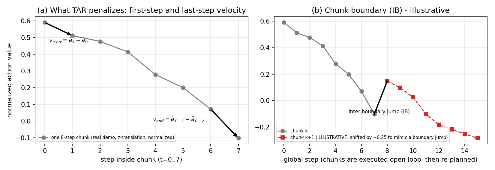
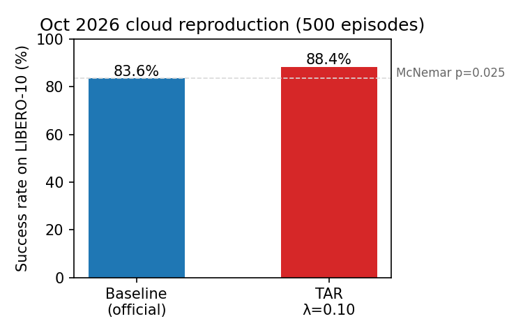
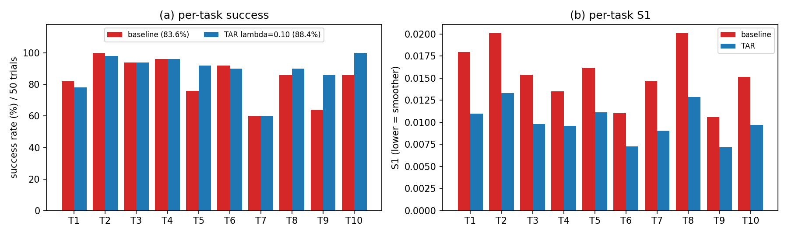
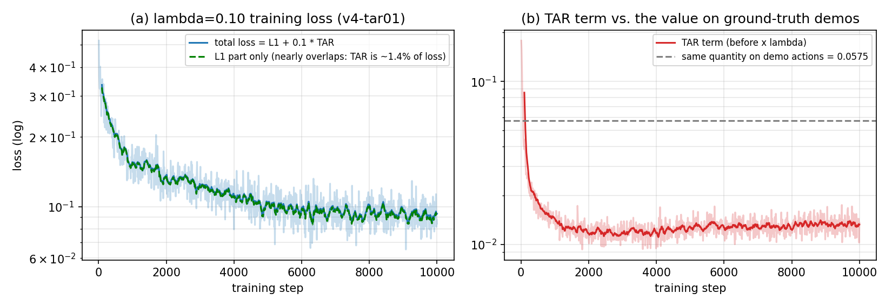
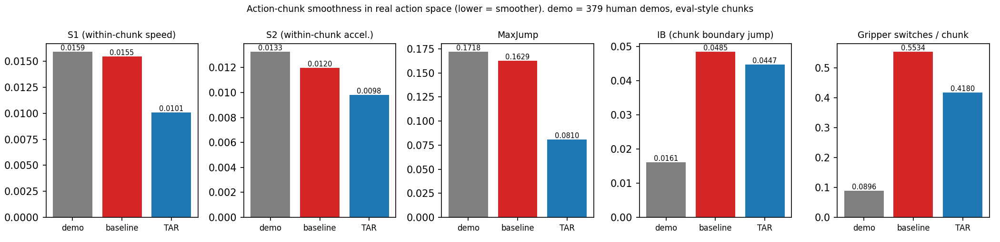
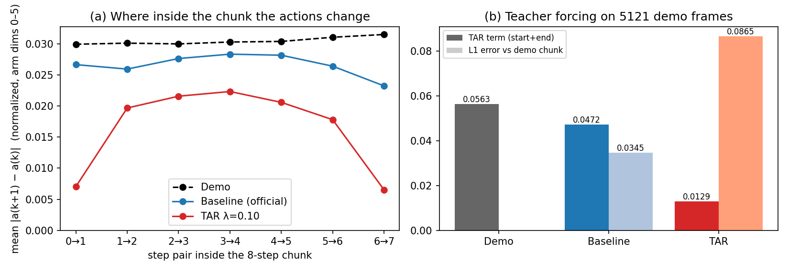
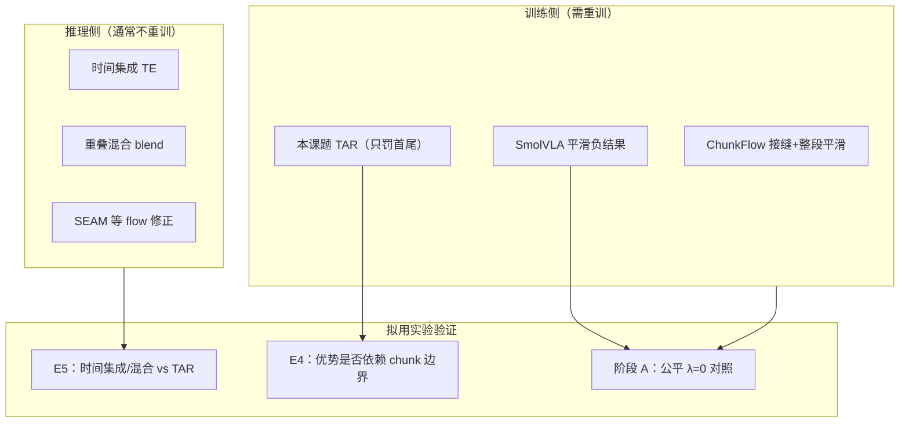
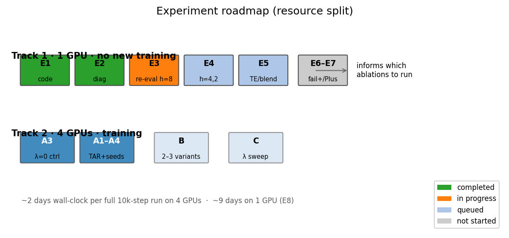

# TAR 课题 · 实验进度讲解稿

**日期**：2026-11-19  
**作者**：何宁秋  
**摘要版**：[20261119-实验进度与计划.md](20261119-实验进度与计划.md)  
**展开版**：[20261118-实验盘点、文献调研与实验重规划.md](20261118-实验盘点、文献调研与实验重规划.md)

---

## 常用术语（文中英文缩写见下表）

| 说法 | 含义 |
|------|------|
| **动作块（chunk）** | 模型**一次前向**输出的连续多步动作；本课题为 **8 步**。 |
| **开环步数 / 执行视界** | 每得到 8 步预测后，**实际执行其中几步**再重新预测（例如 8、4 或 2 步）。 |
| **TAR** | 训练时在损失里惩罚 chunk **第 1 步相对第 0 步**、**第 7 步相对第 6 步**变化过大；推理不增加计算。 |
| **λ（lambda）** | TAR 惩罚的权重；**λ=0** 表示关闭 TAR，仅保留动作 L1 损失。 |
| **训练 recipe** | 除是否用 TAR 外，学习率、batch、训练步数等配置与 v4-tar01 **一致**。 |
| **随机种子（seed）** | 控制数据打乱与初始化；换种子重训可检验结论是否稳定。 |
| **时间集成（TE，Temporal Ensembling）** | **环境每走 1 步就重新调用模型**；对同一时刻的多次预测做指数加权平均，轨迹往往更平滑，但**模型调用次数约为「预测 8 步只执行 8 步」情形的约 8 倍**。 |
| **重叠混合（blend）** | 仍每次预测 8 步，但只先执行前 4 步；下一段预测到达时，在重叠的 4 步上对「上一段剩余预测」与「新预测」做**线性混合**，减轻两段之间的接缝（ChunkFlow 论文中的执行策略，**不需重新训练**）。 |
| **示教前向（teacher forcing）** | 用数据集中真实图像与状态输入模型，比较输出与示教动作；**不启动仿真**。 |
| **S1 / IB** | **S1**：一段 chunk **内部**步与步之间变化有多大；**IB**：**两次预测衔接处**的动作跳变有多大。 |
| **实验编号 E1～E9** | 单卡阶段、**只做评测或分析、一般不重训**的任务编号。 |
| **阶段 A～D** | 四卡阶段、需要**重新训练**的任务分组（公平对照、机理消融、λ 扫描、泛化试点）。 |

---

## 实验计划总目标（总结）

本计划不是为了再刷高一个成功率数字，而是要在**能写进论文、能经同行推敲**的前提下，回答下面四类问题，并据此定稿表述与实验优先级。

### 要回答的核心问题

| 序号 | 问题 | 计划靠什么回答 |
|------|------|----------------|
| **1** | **在训练条件公平时，TAR 是否仍比「不用 TAR」更好？** | 四卡 **A3（λ=0，同 recipe）** + 多种子阶段 A |
| **2** | **收益主要来自 chunk 首尾，还是整体动作更平滑？** | 单卡 **E2**（已有）；**E4** 改变开环步数；四卡 **B1** 等消融（按 E4 结果选做） |
| **3** | **不重训的平滑办法（时间集成、重叠混合）能否达到类似效果？TAR 的价值是否仍在？** | 单卡 **E5** |
| **4** | **失败与泛化：剩的失败是什么类型；扰动下是否更稳** | **E6** 失败分类；**E7** LIBERO-Plus（可选） |
| **5** | **论文与文献是否一致：避免夸大，能说清「和 SmolVLA 负结果、ChunkFlow 等有何不同」** | **E2/E5** 数据 + **E9** 修订 + 文献对照（第 5 页） |

### 已有结果能支撑什么、不能支撑什么

- **能支撑**：在云上与官方 BitVLA 对比，TAR（λ=0.10）成功率更高且统计显著；轨迹 **chunk 内部**更平滑；E2 表明训练目标**确实压住了首尾**。
- **不能单独支撑**：「TAR 优于同条件无 TAR baseline」（缺 A3）；「主要解决了 chunk 接缝」（IB 改善很小，需 E4）；「优于一切推理侧技巧」（需 E5）。

### 为什么分「单卡轨道」和「四卡轨道」

```text
单卡轨道（E1～E9）         四卡轨道（阶段 A～D）
──────────────────         ─────────────────────
不重训、成本低、可先跑      重训、是主结论的硬证据
弄清现象与机制线索          公平对照 + 稳健性 + 必要消融
为四卡「选做哪几条」        论文里「方法有效」的支柱
```

**单卡轨道的目标**：在只有一张 GPU 时，把**能靠评测和诊断完成**的证据攒齐——复现并记录完整轨迹、扫开环步数、对比时间集成与重叠混合、分类失败原因，并修正论文草稿中与数据/文献不符的表述。

**四卡轨道的目标**：在训练条件与 v4-tar01 **完全一致**的前提下，补上**唯一变量是「有没有 TAR」**的对照（A3），并用多种子与少量机理实验支撑论文主张；λ 扫描与跨套件试点视主结论是否成立再展开。

### 计划完成时的交付物（对论文而言）

1. **主表**：公平条件下的成功率（至少一种子一对：λ=0 vs λ=0.10；理想情况多种子区间）。
2. **机理论述**：有 E2/E4（及可能的 B 阶段）支撑的「边界 vs 整体」结论，不靠口号。
3. **定位段落**：E5 支撑的「与重训无关的平滑技巧」对比，说明 TAR 的适用场景（训练一次、推理无额外开销）。
4. **补充分析**：轨迹指标（S1、接缝相关指标）、失败类型（E6）、可选扰动评测（E7）。
5. **文稿合规**：删除「首个」「消除边界」等不成立表述，related work 与 ChunkFlow、SEAM、SmolVLA 负结果等对齐。

后续分页内容（第 0～16 页）是在上述总目标下，**每一步的具体目标、已有结果与配图**。

---

## 阅读说明

- 每一节对应文档中的一页：结构为 **目标 → 结果 / 数据 → 配图 → 说明**。
- 配图位于 `report/figures/`，在本文档目录下 Markdown 预览即可显示。

---

## 目录

| 页 | 章节 |
|----|------|
| — | [实验计划总目标（总结）](#实验计划总目标总结) |
| 0 | [摘要](#第-0-页摘要) |
| 1 | [问题与 TAR 做法](#第-1-页问题与-tar-做法) |
| 2 | [已有主结果（10 月云复现）](#第-2-页已有主结果10-月云复现) |
| 3 | [平滑度与 chunk 边界](#第-3-页平滑度与-chunk-边界) |
| 4 | [对照缺口与 E2 诊断](#第-4-页对照缺口与-e2-诊断) |
| 5 | [相关文献与假设](#第-5-页相关文献与假设) |
| 6 | [实验计划总览](#第-6-页实验计划总览) |
| 7～15 | [轨道 1 / 轨道 2 分项](#轨道-1单卡分项) |
| 16 | [资源与论文范围](#第-16-页资源与论文范围) |

---

## 第 0 页：摘要

**目标**：概括已完成工作、主要结论与下一步。

**结果**：

1. LIBERO-10 上 TAR（λ=0.10，10K 步）相对官方 BitVLA：**88.4% vs 83.6%**（成功率相差 **4.8 个百分点**，配对检验 **p=0.025**）；对照模型训练步数约差 **10 倍**，严格结论有待 **A3（同 recipe、λ=0 重训）**。
2. 单卡轨道：E1、E2、E8 已完成；**E3～E5** 评测队列运行中（不重训）。
3. 四卡到位后优先 **A3**；单卡实验用于筛选后续消融，**不能替代** A3。

**说明**：现有结果支持「TAR 有效」的初步判断；公平条件下的对照与多种子验证放在轨道 2。

---

## 第 1 页：问题与 TAR 做法

**目标**：说明「一次预测多步动作」与 TAR 所约束的量。



**图示要点**：

- 策略一次预测 **8 步**动作；执行若干步后重新规划，相邻两段预测在衔接处易出现不协调。
- **TAR** 在训练损失中增加对 **第 0→1 步**、**第 6→7 步**变化过大的惩罚（λ=0.10，叠加于 L1）。
- 推理阶段无额外开销，仍为单次前向得到 8 步。

**说明**：TAR 针对与下一段衔接相关的首尾步，实现为损失项层面的小幅改动。

---

## 第 2 页：已有主结果（10 月云复现）

**目标**：列出当前可写入论文的成功率与训练配置。





| 指标 | Baseline（官方权重） | TAR v4-tar01 |
|------|----------------------|--------------|
| 总成功率 | **83.6%** | **88.4%** |
| 统计 | 与 TAR 配对检验 **p = 0.025** | 高 **4.8 个百分点** |
| 失败类型 | 全部为**超时** | 全部为超时（次数更少） |
| 训练 | 权重文件名提示约 **100K 步** | **10K 步**，四卡分布式训练 |



**说明**：10 月云环境完成 TAR 训练与 500 次任务评测；逐任务结果见 fig4。Baseline 为官方 checkpoint，非同条件 λ=0 重训，步数差异见第 4 页。

---

## 第 3 页：平滑度与 chunk 边界

**目标**：补充轨迹侧指标，区分 chunk **内部**与**衔接处**的变化。



| 指标 | 含义 | Baseline | TAR |
|------|------|----------|-----|
| **S1** | chunk **内部**平均步间变化 | 0.0155 | **0.0101** |
| **IB** | **两次预测接缝**处跳变 | 0.0485 | 0.0447（约 −8%） |

**说明**：TAR 显著降低 chunk 内变化量，接缝处（IB）改善有限。论文表述应避免「消除边界跳变」；边界是否关键由 E4 与阶段 B 进一步检验。

---

## 第 4 页：对照缺口与 E2 诊断

**目标**：说明 A3 的必要性；给出 11-18 示教前向诊断（E2）结论。



**图 (a)**：

- 横轴：chunk 内 **0→1 … 6→7** 各相邻步。
- Baseline 与示教曲线形态接近；TAR 呈 **倒 U 形**，**首尾步**变化明显低于 Baseline → TAR 项在训练目标中**集中作用于边界步**。

**图 (b)**：

| | TAR 项（首尾，归一化） | 相对示教 chunk 的 L1 |
|--|------------------------|----------------------|
| 示教 | 0.056 | — |
| Baseline | 0.047 | 0.035 |
| TAR | **0.013** | 0.087 |

**说明**：E2 在 5121 帧示教上只做前向、不跑仿真。TAR 首尾项相对 Baseline 约降至 1/4；TAR 对示教的 L1 更大，而官方 Baseline 更贴示教但成功率更低，提示存在训练步数等混杂。**A3** 需在与 v4-tar01 相同 recipe 下训练 λ=0，仅关闭 TAR 项。

---

## 第 5 页：相关文献与假设

**目标**：归纳与后续实验直接相关的文献，并对应到待验证问题。



**文献摘表**：

| 工作 | 要点 | 本课题用法 |
|------|------|------------|
| **ChunkFlow** | 训练时惩罚接缝与整段变化；执行时可用**重叠混合** | E5 中的混合基线；B1 对齐全段速度惩罚 |
| **SEAM** | 边界处加速度抖动常高于 chunk 内部 | E1/E3 区分边界与内部指标 |
| **SmolVLA 负结果** | 另一架构上加平滑惩罚损害成功率 | 讨论 L1 全参微调场景下的差异 |
| **AutoHorizon 等** | 开环步数与成功率的关系非单调 | E4：开环步数 2 / 4 / 8 |

**说明**：边界不平滑在文献中较常见，但平滑正则在不同设定下结论相反。本模型为确定性回归输出，仍可在**不重训**前提下试**时间集成**与**重叠混合**（E5）；主结论的公平性依赖阶段 A 的 λ=0 对照与多种子训练。

---

## 第 6 页：实验计划总览

**目标**：单卡（轨道 1）与四卡（轨道 2）分工及当前状态（路线图颜色为 11-18 快照）。



**说明**：轨道 1 以评测与诊断为主，为轨道 2 的消融选择提供依据（例：E2 显示夹爪约占 TAR 项 10%，「训练时屏蔽夹爪」实验 B2 可后置）。轨道 2 中 **A3（λ=0 同 recipe）** 为最高优先级训练任务。

---

## 轨道 1（单卡）分项

格式：**目标 → 做法 → 结果 → 配图 → 说明**。

---

### 第 7 页 · E1 评测代码

| | 内容 |
|--|------|
| **目标** | 保存完整预测 chunk 与实际执行动作；支持不同**开环步数**、**时间集成（TE）**、**重叠混合（blend）**。 |
| **做法** | 扩展评测脚本；新增轨迹分析脚本。 |
| **结果** | 已完成。默认「预测 8 步、执行 8 步」模式与 10-22 分片评测**逐位一致**；时间集成与重叠混合已通过短程试跑。 |
| **配图** | 概念见 [fig1](figures/fig1_tar_concept.png) |

**说明**：E3～E6 依赖该评测管线；改动未改变默认设置下的数值结果。

---

### 第 8 页 · E2 示教诊断

| | 内容 |
|--|------|
| **目标** | 在不重训、不仿真的前提下量化 TAR 对 chunk 首尾及夹爪维度的影响。 |
| **做法** | 5121 帧示教前向；对比示教、Baseline、TAR。 |
| **结果** | TAR 项约降 **73%**；首尾变化约降至 Baseline 的 **1/4**；夹爪占 TAR 项约 **10%**。 |
| **配图** | [fig5](figures/fig5_tf_diag_profile.png)（见第 4 页） |

**说明**：E2 为 11-18 完成的机制侧证据，支撑「TAR 主要约束边界步」的表述。

---

### 第 9 页 · E8 单卡训练可行性

| | 内容 |
|--|------|
| **目标** | 验证单卡能否在参数 offload 到 CPU 内存的情况下跑通满 recipe 全参数微调。 |
| **做法** | 短程训练试跑；独占 GPU。 |
| **结果** | 可行；四卡仍为首选（与 v4-tar01 训练方式一致）。 |
| **配图** | [fig6](figures/fig6_experiment_roadmap.png) |

**说明**：若暂无法使用四卡，可用单卡跑 A3，但训练与大规模评测难以同时进行。

---

### 第 10 页 · E3 重评

| | 内容 |
|--|------|
| **目标** | 核对 88.4% / 83.6%；保存每场仿真的原始动作用于后续分析。 |
| **做法** | 两模型各 500 次任务评测，开环步数 8；后台队列并行运行。 |
| **结果** | **进行中**（11-18 启动，含 TAR 与 Baseline 各两路分片；完成后自动进入 E4）。 |
| **配图** | 结束后由分析脚本汇总平滑度与失败相关指标 |

**说明**：E3 为轨道 1 当前主任务；具体 episode 计数可按需自服务器日志查询（不在本文档中维护分片表）。

---

### 第 11 页 · E4 执行视界

| | 内容 |
|--|------|
| **目标** | 固定权重，改变**每次预测后实际执行几步**（2 / 4 / 8），看 TAR 相对 Baseline 的成功率差距是否变化，从而判断收益是否依赖「在被约束的首尾步上」切换 chunk。 |
| **做法** | 与 E3 相同评测协议，开环步数为 4 或 2（8 步由 E3 覆盖）。 |
| **结果** | 排队中，待 E3 结束后启动。 |

**说明**：无需重训即可部分回答「边界机制」问题。

---

### 第 12 页 · E5 推理侧平滑对比

| | 内容 |
|--|------|
| **目标** | 在不重训前提下，比较：**时间集成（TE）**、**重叠混合（blend）** 能否让 Baseline 接近 TAR 的成功率与平滑度。 |
| **做法** | 重叠混合：两模型各完整 LIBERO-10 评测；时间集成：先在少数任务上试跑（因每步都调用模型，成本较高）。 |
| **结果** | 排队中。短程试跑：重叠混合可正常完成一局；时间集成单局调用次数多、易触发超时。 |

**说明**：若重叠混合已足够，TAR 的贡献侧重「训练一次、推理无额外开销」；若时间集成很平滑但成功率下降，与 SEAM 等报告一致，需在文中讨论。

---

### 第 13 页 · E6 / E7 / E9

| 步骤 | 目标 | 状态 |
|------|------|------|
| **E6** | 失败模式分类（超时、停滞、抓取异常等） | 等待 E3 数据 |
| **E7** | 扰动基准 LIBERO-Plus 上评测两模型 | 未开始，需独立环境 |
| **E9** | 论文表述与参考文献修订 | 未开始 |

**说明**：E6 依赖 E3 保存的轨迹；E7 仅评测、不需训练；E9 与实验并行推进。

---

## 轨道 2（四卡）分项

### 第 14 页 · 阶段 A

| 训练 | 目标 | 状态 |
|------|------|------|
| **A3** λ=0 | 同 recipe 公平对照 | 未开始，**最高优先级** |
| **A1/A2** | TAR，多种子 | 未开始 |
| **A4** 等 | 第二随机种子下的 λ=0 | 建议 |

**说明**：除 λ 与随机种子外，超参数与 v4-tar01 对齐。通过标准：各 seed 上 TAR 成功率高于同 seed 的 λ=0（阈值见 11-18 报告 G1）。

---

### 第 15 页 · 阶段 B / C / D

| 阶段 | 目标 | 启动条件 |
|------|------|----------|
| **B** | 机理消融（全段惩罚 B1、屏蔽夹爪 B2、示教平滑 B3 等） | E4/E5 后选定少数项 |
| **C** | λ 敏感性（0.05 / 0.20 / 0.50 等） | 阶段 A 通过后 |
| **D** | 其它 LIBERO 套件试点 | 视 C 与资源 |

**说明**：阶段 B 不全量展开；E2 已支持降低 B2 优先级。

---

## 第 16 页：资源与论文范围

以下为当前计划所依赖的外部条件，讨论时一并说明即可。

1. **四卡训练资源**：决定 A3 及阶段 A 是在四卡上与 v4-tar01 同方式训练，还是暂用单卡 offload。
2. **论文泛化部分**：是否纳入 **LIBERO-Plus** 扰动评测（E7，仅评测、需单独配置环境）。

**说明**：轨道 1 队列继续运行；四卡可用时训练顺序拟为 **A3 → A1**。

---

## 附录 A：图示索引

| 文件 | 章节 |
|------|------|
| `fig1_tar_concept.png` | 第 1 页 |
| `fig7_success_oct2026.png`、`fig4_per_task.png`、`fig2_training_curves.png` | 第 2 页 |
| `fig3_smoothness_demo_base_tar.png` | 第 3 页 |
| `fig5_tf_diag_profile.png` | 第 4、8 页 |
| `fig6_experiment_roadmap.png` | 第 6、9 页 |
| `fig0_example_input.png` | 可选（双相机输入） |

---

## 附录 B：摘要（一页）

云复现：TAR **88.4%** vs 官方 Baseline **83.6%**（**p=0.025**）；Baseline 训练步数约为 TAR 的十倍量级，须完成 **λ=0 同 recipe 重训（A3）**。E2 表明 TAR 主要压低 chunk 首尾变化。轨道 1 正在重评并扫描开环步数与时间集成/重叠混合；四卡优先 A3，轨道 1 结果用于筛选轨道 2 消融项。